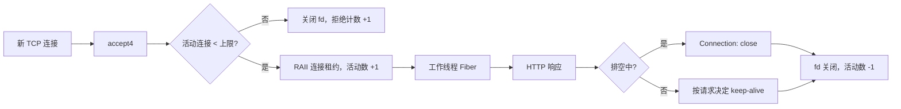

# 连接容量控制与两阶段排空

这次迭代解决两个真实问题：连接激增时，每连接一个 Fiber 和 fd 会持续消耗内存；滚动更新时，直接停止 I/O 会截断正在处理的请求。

## 请求链路



`TcpServer` 在**投递 Fiber 之前**检查连接上限，活动计数包含等待 worker 执行的连接；租约销毁时关闭 fd 并减计数。检查和递增都在单个 acceptor 线程执行，worker 只减计数。达到上限时关闭刚接受的 TCP 连接，不返回 HTTP 503，因为此时请求还没有被解析。内核 backlog 中的连接仍可能完成 TCP 握手，因此客户端应处理连接被立即关闭的情况。`setMaxConnections(0)` 表示不限制；HTTP 示例默认 4096，可通过 `SYLAR_MAX_CONNECTIONS` 调整。

`GET /metrics` 提供当前活动连接、累计拒绝连接和上限（Prometheus 文本格式）。一次抓取本身也占用连接，因此活动数可能包含抓取请求。满额时 `/metrics` 和 `/ready` 也可能无法接入；外部采集应将失败作为容量信号，避免把它解释成进程崩溃。

## 关闭顺序

1. Kubernetes `preStop` 向 PID 1 发送 `SIGUSR1`。服务进入排空状态，`/ready` 返回 503；随后等待 5 秒，让 endpoint 变化有机会传播。此期间已接入的普通 HTTP 请求仍可完成，但响应会带 `Connection: close`。
2. 收到 `SIGTERM` 后停止监听新连接，并等待活动连接数归零。默认最多等待 10 秒，可用 `SYLAR_DRAIN_TIMEOUT_MS` 配置（最大 60 秒）。
3. 截止时间到达时停止 IOManagerPool，取消未完成的 I/O；WebSocket、长请求及空闲连接可能被中断。Docker/Kubernetes 的终止宽限时间必须覆盖 preStop、排空等待和进程清理。清单目前配置 5 秒 + 10 秒默认等待，宽限 20 秒。

`SIGINT` 也执行后两步，便于本地退出。`HttpServer::beginDrain()` 是库接口，`HttpServer::stop()` 会先置排空状态。应用可在停止监听前自行安排就绪撤销窗口。

## 探针与故障边界

- `/ready` 在排空时返回 503；连接满额时探针自身可能被立即关闭，Kubernetes 也会将其视为探针失败。readiness 控制新连接进入 Service 的资格，不会迁移已有连接。
- `/health` 仍可供人工 HTTP 检查。部署清单用进程存活检查作为 liveness，避免容量满额使 HTTP liveness 失败而触发重启风暴。这个检查**不能发现事件循环死锁**；生产化应提供独立于业务连接上限的管理端口或更可靠的看门狗。
- 连接上限是本进程内的资源保护，不是全局限流，也不限制每连接的请求速率或请求体内存。协议层已有请求体上限，但仍需基于实际负载调节 fd 限制、内存与 worker 数。
- 没有无损 WebSocket 迁移、请求重放或跨副本会话。超过排空期限后可能中断在途操作，客户端必须针对幂等请求设计重试。

## 验证

```bash
cmake --build build-core -j --target http_server
python3 tests/test_http_drain_app.py ./build-core/sylar/http_server
```

集成测试覆盖满额拒绝及计数、SIGUSR1 导致 readiness 503、排空时关闭 keep-alive、SIGTERM 下分段请求完成、超时后强制退出。`tests/test_http_cluster.py` 继续验证多进程故障隔离。部署清单只做静态检查；本机没有运行 Kubernetes 集群。
