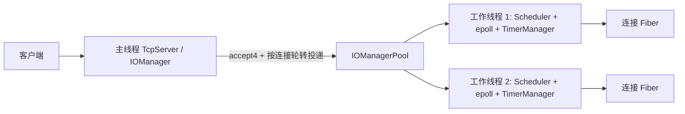
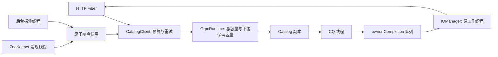

# 协程网络架构

- Boost.Context 保存有栈 Fiber 的上下文。每个 Fiber 只在创建它的 I/O 工作线程恢复。
- 每个 IOManager 独占一个 Scheduler、epoll 实例和定时器队列。跨线程 `post()` 将回调放入队列，通过 eventfd 唤醒目标线程。
- TcpServer 在主线程接受非阻塞连接，投递 Fiber 前可按活动连接上限拒绝新 fd，工作线程拥有连接处理回调和连接 fd。网络模块显式调用 `waitReadable` / `waitWritable`；可选 POSIX Hook 为已有非阻塞 socket 提供 Fiber 感知等待。echo 会话每条连接只设一个空闲期限，在读写进展时更新时间戳。
- HTTP 示例的 `SIGUSR1` 先撤销 readiness，随后 `SIGTERM` 停止监听并限时等待活动连接；超时后取消剩余 I/O 并回收工作线程。完整顺序见[连接容量与排空](admission_and_drain.md)。

当前范围包含 IPv4/IPv6/Unix TCP 服务、UDP Socket、HTTP/HTTPS、WebSocket、日志、YAML 配置、单线程与多线程 I/O 调度。Hook 覆盖常用 socket 调用与睡眠，具体边界见 [Hook](hook.md)。性能结论仅来自同机 WSL 压测，尚无跨机器数据。

## 多副本部署层

多个 `http_server` 进程可以部署为独立 Pod。Kubernetes Service 根据 readiness 将**新 TCP 连接**转发到一个副本；每个副本内部保持上述线程与 Fiber 拓扑。应用路由应保持无状态，持久化数据须在外部系统中定义一致性和故障策略。Deployment、Service 和本机双进程测试见 [多副本部署](distributed_deployment.md)。

面试时可直接打开 [交互式架构动画](architecture_demo.html) 切换正常、故障和滚动更新场景。该动画描述连接流向，不声称跨 Pod 会话迁移或无损请求重试。

## 外部 gRPC 调用

可选 `sylar_grpc` 模块用 worker Completion 队列适配 CQ：网关 Fiber 发起 unary RPC 后让出，CQ 发布结果并通过 owner 的已有 eventfd 唤醒，owner 批量完成等待、在原线程恢复 Fiber。调用状态一直保留到 CQ 回收；Completion 通过生命周期门控阻止 owner 销毁后的访问。没有改变 Fiber 线程归属规则。旧 per-call eventfd 模式保留用于性能对照。

客户端用不可变端点快照复用 channel，支持只读预算重试、故障摘除与后台探测、显式下游保留容量。可选 ZooKeeper 临时节点注册与周期发现，在快照过期后撤销主目录。traceparent 关联 HTTP server、RPC client 与后端 server span。Catalog 使用 gRPC 同步 handler。详细时序、资源和生命周期见 [gRPC 架构](grpc.md)、[治理手册](rpc_governance.md)；实测资源变化见 [RPC 基准](rpc_benchmark.md)。

## 追踪导出隔离

TraceRecorder 在短临界区固定不可变 span 引用，在锁外编码 JSON。网关 /traces 经独立 BlockingExecutor 执行，不占用 I/O worker 做整批编码；独立准入最多两个任务，等待继承父预算并受500 ms上限约束。原RPC CQ与Fiber线程归属不变。实现、失败实验与资源代价见[调优报告](performance/rpc_tuning.md)。
