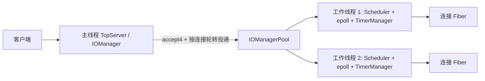

# 协程网络架构

- Boost.Context 保存有栈 Fiber 的上下文。每个 Fiber 只在创建它的 I/O 工作线程恢复。
- 每个 IOManager 独占一个 Scheduler、epoll 实例和定时器队列。跨线程 `post()` 将回调放入队列，通过 eventfd 唤醒目标线程。
- TcpServer 在主线程接受非阻塞连接，工作线程拥有连接处理回调和连接 fd。网络模块显式调用 `waitReadable` / `waitWritable`；可选 POSIX Hook 为已有非阻塞 socket 提供 Fiber 感知等待。echo 会话每条连接只设一个空闲期限，在读写进展时更新时间戳。
- `SIGINT` / `SIGTERM` 由 signalfd 进入主线程事件循环。停止监听后取消待处理 I/O，再回收工作线程。

当前范围包含 IPv4/IPv6/Unix TCP 服务、UDP Socket、HTTP/HTTPS、WebSocket、日志、YAML 配置、单线程与多线程 I/O 调度。Hook 覆盖常用 socket 调用与睡眠，具体边界见 [Hook](hook.md)。性能结论仅来自同机 WSL 压测，尚无跨机器数据。

## 多副本部署层

多个 `http_server` 进程可以部署为独立 Pod。Kubernetes Service 根据 readiness 将**新 TCP 连接**转发到一个副本；每个副本内部保持上述线程与 Fiber 拓扑。应用路由应保持无状态，持久化数据须在外部系统中定义一致性和故障策略。Deployment、Service 和本机双进程测试见 [多副本部署](distributed_deployment.md)。

面试时可直接打开 [交互式架构动画](architecture_demo.html) 切换正常、故障和滚动更新场景。该动画描述连接流向，不声称跨 Pod 会话迁移或无损请求重试。
