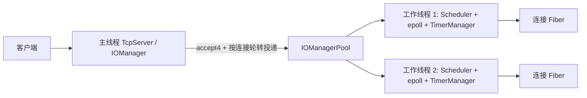

# 协程网络架构

- Boost.Context 保存有栈 Fiber 的上下文。每个 Fiber 只在创建它的 I/O 工作线程恢复。
- 每个 IOManager 独占一个 Scheduler、epoll 实例和定时器队列。跨线程 `post()` 将回调放入队列，通过 eventfd 唤醒目标线程。
- TcpServer 在主线程接受非阻塞连接，工作线程拥有连接处理回调和连接 fd。读写等待显式调用 `waitReadable` / `waitWritable`；未使用同步 I/O hook。echo 会话每条连接只设一个空闲期限，在读写进展时更新时间戳。
- `SIGINT` / `SIGTERM` 由 signalfd 进入主线程事件循环。停止监听后取消待处理 I/O，再回收工作线程。

当前范围：IPv4 TCP echo、日志与 YAML 配置模块、一次性定时器、单线程与多线程 I/O 调度。尚无 HTTP、TLS、自动 I/O hook 或跨机器性能结论。
