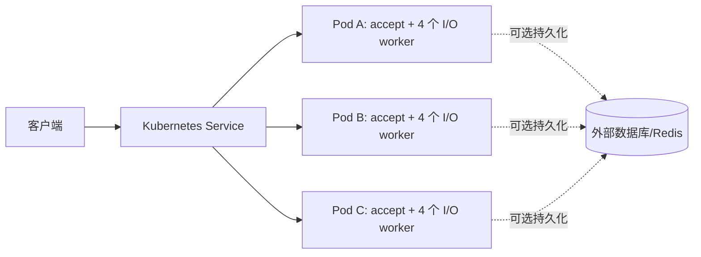

# 多副本 HTTP 部署

本方案把现有 HTTP 示例部署为多个**无状态进程**。每个副本内部仍是一个监听 IOManager、多个工作线程及各自的 Scheduler/epoll/TimerManager。Kubernetes Service 将**新 TCP 连接**送到就绪副本；HTTP keep-alive 或 WebSocket 连接会留在选中的副本。Service 不按每条 HTTP 请求重新均衡。



## 副本接口与生命周期

- `GET /health`：仅证明当前进程可处理 HTTP；用于 startup 和人工检查。liveness 使用进程存活检查，避免满额时 HTTP 探针触发重启。
- `GET /ready`：正常时返回 200，收到预排空信号后返回 503；满额时探针也可能被关闭。它**不检测**外部数据库，也不代表已有连接能无损迁移。
- `GET /instance`：返回 `SYLAR_INSTANCE_ID`，否则使用 `HOSTNAME`，最后回退到 `local`；用于观察负载分配。只接受长度不超过 128 的 ASCII 字母、数字、点、下划线或短横线。
- `GET /metrics`：当前活动连接、累计拒绝连接和连接上限。
- `SIGUSR1`：进入排空状态，readiness 变为 503，新完成的 HTTP 响应关闭 keep-alive；Kubernetes `preStop` 随后等待 5 秒供 endpoint 状态传播。
- `SIGTERM`：停止监听，默认等待活动连接最多 10 秒，然后停止 worker。截止后未完成的 I/O 可能被取消。详细状态机和限制见[连接容量与排空](admission_and_drain.md)。

HTTP 示例路由没有进程内会话状态，因而可以横向复制。SQLite 本地文件、进程内配置或日志不能当成跨副本共享状态；需要持久化时应由应用明确接入外部 MySQL/Redis 等适配器，并定义一致性和故障语义。仓库另有 [Redis Streams 跨副本 WebSocket 演示](redis_stream_cluster.md)，按 ID 补读与保留窗口缺口由双进程测试覆盖；分布式事务与通用自动请求重放未实现。

## 本机验证

无需容器运行时：

```bash
cmake -S . -B build -DCMAKE_BUILD_TYPE=Release
cmake --build build -j --target http_server
python3 tests/test_http_cluster.py ./build/sylar/http_server
```

测试启动两个独立副本，验证 `/health`、`/ready`、`/instance`，关闭其中一个，再验证另一副本继续服务。它**没有**验证 Kubernetes Service 的真实转发和跨主机网络。

## 容器与 Kubernetes

仓库根目录的 `Dockerfile` 只构建核心 HTTP 示例。运行时为非 root 用户，监听 8080。镜像构建和本地单实例检查：

```bash
docker build -t sylar-http:local .
docker run --rm -p 8080:8080 -e SYLAR_INSTANCE_ID=local-1 sylar-http:local
# 在另一个终端执行：curl http://127.0.0.1:8080/instance
```

在本地 Kubernetes 集群中先把镜像加载到节点；在多机集群中推送到可访问的镜像仓库，并把 `deploy/kubernetes.yaml` 的 `image` 改成**固定版本标签或 digest**。随后：

```bash
kubectl apply -f deploy/kubernetes.yaml
kubectl rollout status deployment/sylar-http
kubectl get pods -l app=sylar-http -o wide
# 本地连通性检查：port-forward 会选定一个 Pod
kubectl port-forward service/sylar-http 8080:80
# 在另一个终端执行：curl http://127.0.0.1:8080/instance
```

`kubectl port-forward service/...` 会选定**一个** Pod，不能用它验证 Service 的负载分配。要从集群内部经过真实 ClusterIP 采样多个新连接，可运行临时客户端：

```bash
kubectl run sylar-probe --rm -i --restart=Never --image=busybox:1.36 -- \
  sh -c 'i=0; while [ "$i" -lt 12 ]; do wget -qO- http://sylar-http/instance; i=$((i+1)); done'
```

多次新连接可能命中不同副本，但小样本不保证覆盖每个副本；结合 `kubectl get pods -o wide` 和 EndpointSlice 检查拓扑。

Deployment 配置 3 个副本、滚动更新 `maxUnavailable: 0`、健康探针、资源请求/限制和基于主机的尽力分散；PodDisruptionBudget 对遵循 Eviction API 的自愿中断要求至少 2 个副本可用；Deployment 的滚动更新由自身策略控制，PDB 不直接约束它。单节点集群仍可调度所有副本；只有运行在不同节点上，才能验证节点级故障容忍。Service 是集群内入口；公网接入、TLS 终止与流量策略需要另配 Ingress/Gateway。滚动更新前应验证长连接排空策略，现有示例尚不提供无损迁移。5 秒 preStop 计入 20 秒的总终止宽限期。连接上限默认 4096；满额会拒绝新 TCP 连接，HTTP readiness 也可能无法接入。liveness 使用进程存活检查，避免高负载时的重启风暴，但不能检测事件循环死锁。

本开发环境没有 Docker 或 kubectl；这里只验证了 Dockerfile/清单的静态内容与本机多进程行为，**未执行镜像构建或 Kubernetes 端到端部署**。

## 官方语义参考

- [Kubernetes Service](https://kubernetes.io/docs/concepts/services-networking/service/)：多个 Pod 的网络入口与 endpoint。
- [kubectl port-forward](https://kubernetes.io/docs/reference/kubectl/generated/kubectl_port-forward/)：Service 目标最终选定一个 Pod。
- [Startup、Readiness、Liveness 探针](https://kubernetes.io/docs/concepts/workloads/pods/probes/)：就绪状态及 Service endpoint 的关系。
- [PreStop 生命周期钩子](https://kubernetes.io/docs/concepts/containers/container-lifecycle-hooks/)：TERM 之前执行，时间计入终止宽限期。
- [PodDisruptionBudget](https://kubernetes.io/docs/concepts/workloads/pods/disruptions/)：Eviction API 下的自愿中断约束及滚动更新边界。
