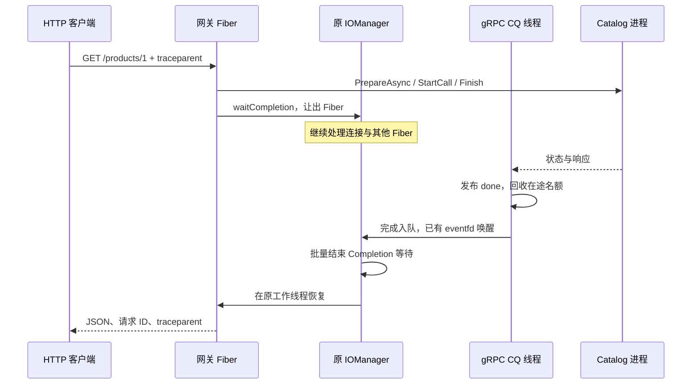

# gRPC 微服务架构与运行

HTTP 网关通过异步 unary gRPC 调用独立 Catalog 服务，形成跨进程的只读商品查询链路。可选模块隔离依赖，默认核心不需要 gRPC。2026-10-03 版本已包含容量隔离、摘除恢复、只读重试、ZooKeeper 发现、有界追踪及 worker 完成通知。

详细说明见 [治理手册](rpc_governance.md)、[真实性能基准](rpc_benchmark.md)、[面试准备](interview/grpc.md)。

## 模块划分

| 层 | 源码 | 职责 |
| --- | --- | --- |
| 契约 | `proto/catalog.proto` | versioned GetProduct、整数分价格、实例与请求身份、追踪字段 |
| 运行时 | `include/rpc/GrpcRuntime.hpp` | 通用 unary、CQ、deadline、取消、容量和完成通知 |
| 类型客户端 | `include/rpc/CatalogClient.hpp` | 只读重试、共享令牌、端点更新 |
| 目录 | `include/rpc/EndpointDirectory.hpp` | channel 复用、快照、健康与探测 |
| 发现 | `include/rpc/ZkDiscovery.hpp` | 可选 ZooKeeper 注册与周期发现 |
| 追踪 | `include/rpc/Trace.hpp` | traceparent、父子 span、有界 JSON |
| 后端 | `sylar/app/catalog_server.cpp` | 独立监听、gRPC 同步 handler、正常停机 |
| 网关 | `sylar/app/rpc_gateway.cpp` | HTTP 路由、校验、监控、排空 |

目标 `sylar_rpc_contract` 管理生成代码，`sylar_grpc` 管理适配。后端业务为三个只读商品，无写事务、去重存储或 streaming RPC。

## 调用时序



网关每个 runtime 有一个自建 CQ 轮询线程，gRPC 还有内部线程。CQ 不恢复 Fiber；Boost.Context 必须回到所属 IOManager。旧 per-call eventfd 模式仅保留用于基准对照。

请求、响应、ClientContext、reader 由共享调用状态持有到 CQ 回收。Fiber 提前超时只取消并返回本地错误，不读仍可能由 gRPC 写入的响应。Completion 持有 owner 生命周期门控，IOManager 销毁后晚到通知不会访问已释放对象。

`shutdown` 拒绝新调用，取消在途请求，关闭并排空 CQ，最后 join。调用方需在 runtime 析构前结束使用。Catalog 后端仍使用 gRPC 同步 handler，故障演示延迟每约 2 ms 检查取消；客户端取消不能保证任意阻塞业务立即停止。

## 快速启动

核心依赖见 [README](../README.md)，gRPC 另外需要：

```bash
sudo apt-get install libgrpc++-dev libprotobuf-dev protobuf-compiler protobuf-compiler-grpc pkg-config
cmake -S . -B build-grpc -DCMAKE_BUILD_TYPE=Release -DSYLAR_WITH_GRPC=ON
cmake --build build-grpc -j
ctest --test-dir build-grpc --output-on-failure
```

在独立终端运行：

```bash
./build-grpc/sylar/catalog_server 50051 catalog-a 0
./build-grpc/sylar/catalog_server 50052 catalog-b 0
./build-grpc/sylar/rpc_gateway 8080 127.0.0.1:50051,127.0.0.1:50052
```

```bash
curl -i -H 'X-Request-Id: interview-001' http://127.0.0.1:8080/products/1
curl http://127.0.0.1:8080/endpoints
curl http://127.0.0.1:8080/metrics
curl http://127.0.0.1:8080/traces
```

商品 1 返回 keyboard、19900 分、副本身份、trace_parent 和 server_elapsed_us。端口 0 可自动分配，日志打印实际端口。

默认 RPC 预算 500 ms，头 `X-Request-Timeout-Ms` 可设置 1..2000 ms，同时受父上下文和 runtime 上限约束。重试共用原预算。默认 TCP 上限 512、HTTP 在处理请求 128、RPC 64、后端业务并发 32、gRPC ResourceQuota 线程上限 64、消息 64 KiB；这些约束分别管理不同资源，不是总内存承诺。

| RPC 结果 | HTTP |
| --- | --- |
| OK | 200 |
| INVALID_ARGUMENT | 400 |
| NOT_FOUND | 404 |
| DEADLINE_EXCEEDED | 504 |
| RESOURCE_EXHAUSTED、UNAVAILABLE、CANCELLED | 503 |
| 其他 | 502 |

`/health` 表示网关存活；`/ready` 检查未排空且主目录存在非 open 端点。`SIGUSR1` 撤销 readiness，`SIGTERM` 限时 2 秒排空再停止 worker、发现和 runtime。CQ 完成计数不能直接等同于 HTTP 响应计数：本地已返回 504，最终 CQ 仍可能报告 CANCELLED。

## 部署与验收

静态双副本使用 [compose.rpc.yaml](../deploy/compose.rpc.yaml)，动态发现另叠加 [compose.rpc.discovery.yaml](../deploy/compose.rpc.discovery.yaml)。容器监听通过 `SYLAR_LISTEN_ADDRESS=0.0.0.0` 设置。启用动态发现需同时构建 ZooKeeper 模块，步骤和配置见 [治理手册](rpc_governance.md)。

本机核心 133/133、仅 gRPC 152/152、所有扩展与基准 159/159。18 项 gRPC C++ 测试、进程故障矩阵、真实 ZooKeeper 会话恢复与基准 smoke 已通过；详细性能不是测试通过所保证的性质，见单独记录。

本机没有 Docker，镜像与 Compose 运行未验收；[CI](../.github/workflows/grpc.yml) 已配置 gRPC 及 ZooKeeper 开关矩阵，远端结果尚未确认。示例为明文 gRPC 和隔离演示网络，没有新增 mTLS、认证或生产 ACL；追踪为 JSON 诊断，不是 OTLP。连接与传输由 gRPC 管理，不能将项目描述为自行实现 HTTP/2 或 gRPC 协议栈。
