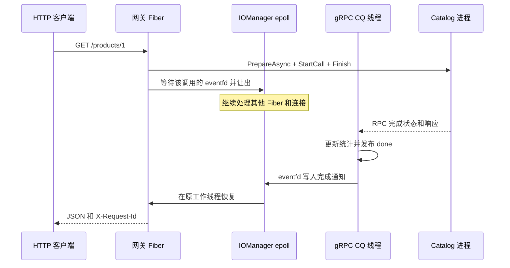

# gRPC 微服务模块架构与运行教程

本模块让现有 HTTP 框架调用独立部署的商品目录服务，用于演示跨进程协议、协程与异步 RPC 接入、请求预算和故障隔离。实现快照为 `0b957aa`，2026 年 10 月 2 日。业务数据是三个只读商品，重点是调用链及其生命周期。

## 模块职责

| 模块 | 入口 | 职责 |
| --- | --- | --- |
| 协议 | `proto/catalog.proto` | `sylar.rpc.v1.Catalog/GetProduct`，商品 ID、整数分价格、副本身份和请求 ID |
| 运行时 | `include/rpc/GrpcRuntime.hpp` | 通用 unary 调用、完成通知、deadline、取消、在途限额和停机 |
| 类型化客户端 | `include/rpc/CatalogClient.hpp` | 按静态端点轮询，复用 channel 和 stub |
| 业务服务 | `include/rpc/CatalogService.hpp` | 商品查询、业务准入、协作取消 |
| HTTP 网关 | `sylar/app/rpc_gateway.cpp` | HTTP 校验、JSON、状态映射、请求 ID 和监控 |
| 独立进程 | `sylar/app/catalog_server.cpp` | gRPC 服务监听、线程资源上限、信号停机 |

gRPC 和生成代码放在独立的 `sylar_grpc` 与 `sylar_rpc_contract` 目标。默认核心构建不寻找 gRPC 依赖；新业务只需添加自己的 Protobuf 接口和类型化客户端。现有 Fiber、Scheduler、IOManager 接口保持可用。

## 调用链



网关只有一个自建 CQ 轮询线程服务多个调用；gRPC 库也会创建内部线程。商品服务使用 gRPC 同步 handler 的工作线程，没有接入本框架的 Fiber 调度。这里的“异步”指网关调用适配，服务端业务处理仍然同步。

每个在途调用持有一个非阻塞 eventfd，因此存在系统调用和 fd 开销。当前选择让 epoll 复用已有的超时、取消和恢复机制；它没有证明是所有负载下最优的通知方案。

## 请求预算与生命周期

网关默认 RPC 预算为 500 ms，HTTP 头 `X-Request-Timeout-Ms` 可指定 1 至 2000 ms。最终预算还受 HTTP 父请求剩余时间和运行时 2 秒上限约束。运行时从单调时钟剩余时间生成 gRPC 要求的绝对 deadline；Fiber 等待仍使用单调时钟。连接建立也消耗这份预算。

`RequestContext` 的取消传递给 `ClientContext::TryCancel`。服务端在故障演示延迟中每约 2 ms 检查 `IsCancelled`，随后提前返回。未来接入数据库时，还需要数据库本身的超时或取消能力；客户端取消不等于服务端任意代码立刻停止。机制参考 [gRPC deadline](https://grpc.io/docs/guides/deadlines/) 与 [gRPC cancellation](https://grpc.io/docs/guides/cancellation/)。

请求、响应、ClientContext、reader 和 eventfd 由调用状态统一持有。调用方、活动注册表和 CQ tag 共享它的所有权。Fiber 提前超时只取消调用并返回本地状态，不读取仍可能由 gRPC 写入的响应。完成队列取回 tag 后发布 `done`，再写 eventfd；恢复的 Fiber 用 acquire 读取完成结果。CQ 不持有 IOManager 裸指针，因此 owner 停止后晚到的完成通知仍可安全回收。

`shutdown()` 先拒绝新调用，取消在途 RPC，再关闭并排空 CQ，最后 join 线程。对象析构前必须停止外部使用者；不要让析构与仍在执行的 `unary` 并发。CQ API 使用方式参考 [官方异步教程](https://grpc.io/docs/languages/cpp/async/)。

## 资源和故障策略

| 资源 | 示例设置 | 超限行为 |
| --- | --- | --- |
| 网关 TCP 连接 | 512 | 现有连接准入策略 |
| HTTP 在处理请求 | 固定 128 | HTTP 准入拒绝 |
| RPC 在途调用 | 默认 64，可配置至 4096 | 立即 RESOURCE_EXHAUSTED，无应用等待队列 |
| 单条 RPC 消息 | 客户端和服务端 64 KiB | gRPC 消息限制 |
| Catalog 业务并发 | 32 | handler 内准入拒绝 |
| Catalog gRPC 线程资源 | ResourceQuota 64 | 由 gRPC 管理线程资源 |
| 网关排空 | 最多 2 秒 | 停止 worker 并取消剩余等待 |

RPC 在途名额一直占用到 CQ 完成回收，防止大量已经超时但仍未结束的 RPC 绕过限额。业务 permit 的作用范围是 handler，RPC 响应传输由 gRPC 管理。64 KiB 是消息大小限制，并非整个传输进程的总内存上限。

客户端采用静态端点轮询，初始化时创建可复用 channel，不在每次请求中重新建连接。没有应用层重试，没有故障摘除。两个副本中一个死亡后，选到它的请求可能 503，选到健康副本的请求仍成功；重启后 channel 可重新连接。这里没有调用已存在的 ZooKeeper 适配器做发现。

| RPC 结果 | HTTP |
| --- | --- |
| OK | 200 |
| INVALID_ARGUMENT | 400 |
| NOT_FOUND | 404 |
| DEADLINE_EXCEEDED | 504 |
| RESOURCE_EXHAUSTED、UNAVAILABLE、CANCELLED | 503 |
| 其他错误 | 502 |

`/health` 只表示网关能响应，`/ready` 只检查网关是否排空；它们不承诺下游可用。`/metrics` 暴露在途、限额、开始、完成、拒绝、失败、deadline 和取消计数。后四项完成状态统计来自 CQ；Fiber 本地先返回 504 后，CQ 最终可能是 CANCELLED，因此不能把该 deadline 计数直接当成 HTTP 504 次数。请求 ID 用于关联响应和 RPC metadata，还没有接入 OpenTelemetry。

## 本机运行

在 Ubuntu 环境安装依赖并配置；非系统 yaml-cpp 仍按 [配置文档](configuration.md) 设置 `CMAKE_PREFIX_PATH`。

```bash
sudo apt-get install libgrpc++-dev libprotobuf-dev protobuf-compiler protobuf-compiler-grpc pkg-config
cmake -S . -B build-grpc -DCMAKE_BUILD_TYPE=Release -DSYLAR_WITH_GRPC=ON
cmake --build build-grpc -j
ctest --test-dir build-grpc --output-on-failure
```

分别在三个终端启动：

```bash
./build-grpc/sylar/catalog_server 50051 catalog-a 0
./build-grpc/sylar/catalog_server 50052 catalog-b 0
./build-grpc/sylar/rpc_gateway 8080 127.0.0.1:50051,127.0.0.1:50052
```

```bash
curl -i -H 'X-Request-Id: interview-001' http://127.0.0.1:8080/products/1
curl -i http://127.0.0.1:8080/products/9
curl http://127.0.0.1:8080/metrics
```

商品 1 返回 keyboard、19900 分及副本身份。多次调用应看到两个副本。端口参数 0 可自动分配空闲端口，启动日志会打印实际端口。

演示慢服务时另开端口：

```bash
./build-grpc/sylar/catalog_server 50053 slow 400
SYLAR_RPC_MAX_INFLIGHT=1 ./build-grpc/sylar/rpc_gateway 8081 127.0.0.1:50053
curl -i -H 'X-Request-Timeout-Ms: 30' http://127.0.0.1:8081/products/1
```

默认仅监听 127.0.0.1。环境变量 `SYLAR_LISTEN_ADDRESS` 可修改监听地址；部署示例设置 0.0.0.0。示例使用明文 gRPC，面向本机和隔离演示网络，不包含服务认证、mTLS 或公网访问控制。客户端接口允许传入其他 ChannelCredentials，但服务端示例没有证书参数。

## 验证与部署范围

本机 Ubuntu 22.04 / GCC 13 Release 使用 gRPC 1.30.2、Protobuf 3.12.4。核心回归 129/129；仅新增 gRPC 后为 140/140；Redis、MySQL、ZooKeeper 与 gRPC 全部开启为 144/144。新增 10 项真实后端 C++ 测试和 1 项多进程故障矩阵，详见 `tests/test_grpc.cpp` 与 `tests/test_grpc_cluster.py`。测试证明的是指定场景下的行为，没有新的 RPC 吞吐量或 P99 测量。

```bash
ctest --test-dir build-grpc -R 'GrpcTest|GrpcCluster' --output-on-failure
docker compose -f deploy/compose.rpc.yaml build
docker compose -f deploy/compose.rpc.yaml up -d
curl http://127.0.0.1:18080/products/1
docker compose -f deploy/compose.rpc.yaml down
```

[Dockerfile.rpc](../Dockerfile.rpc) 与 [Compose 清单](../deploy/compose.rpc.yaml) 提供网关和两个目录副本，后端不暴露主机端口。Compose depends_on 仅控制启动顺序；冷启动 RPC 可能短暂失败。当前机器没有 Docker，镜像和容器网络未实际验收；独立的 Ubuntu 24.04 [gRPC CI](../.github/workflows/grpc.yml) 已配置，尚未得到远端运行结果。

下一步若继续微服务化，应按需求增加动态端点快照与健康摘除、受总预算约束的只读重试、服务认证与 tracing，最后再扩展写请求的幂等键和去重存储。当前代码不包含写操作、分布式事务或一致性保障。
