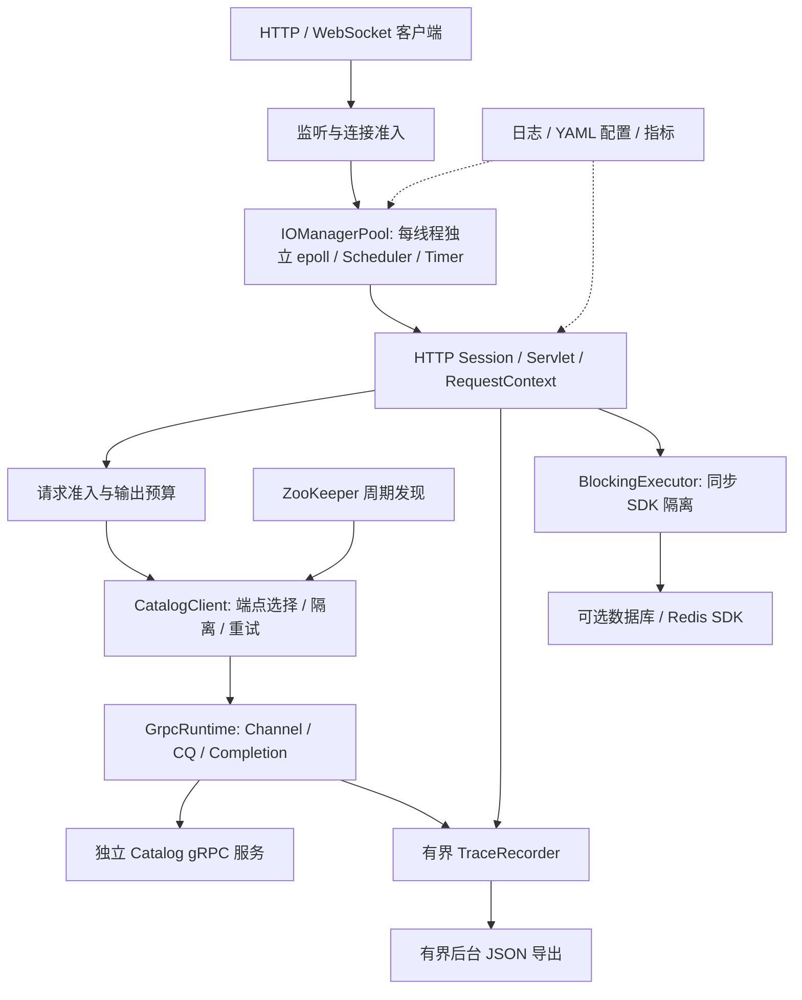
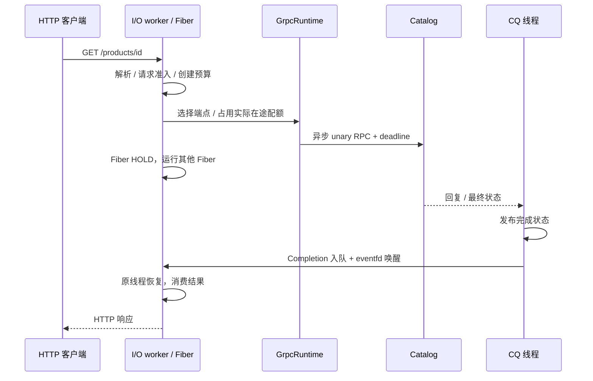
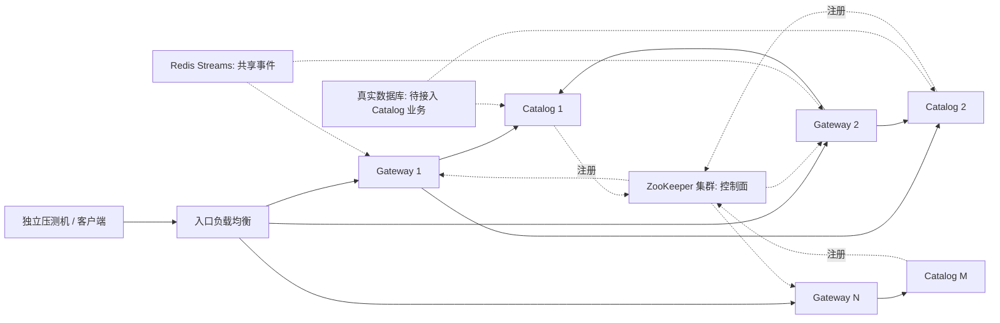

# Sylar 现代 C++ 服务器框架：完整面试准备报告

> 整理日期：2026-10-04。代码基线：`d54549d`。本报告是该代码版本的说明，文档提交本身不改变运行行为。
>
> 性能证据来自历史实验，最新 RPC 实测日期为 2026-10-03；本次整理没有重新压测。全文把“已经实现”“已经测到”“容量假设”“后续计划”分别说明，便于面试时准确回答。

## 阅读导航

1. [项目定位与贡献说明](#一项目定位与贡献说明)
2. [架构、线程与请求链路](#二架构线程与请求链路)
3. [工程问题与解决方法](#三工程问题与解决方法)
4. [性能证据与调优全过程](#四性能证据与调优全过程)
5. [单机预期与多机器容量估算](#五单机预期与多机器容量估算)
6. [衍生问题与回答骨架](#六衍生问题与回答骨架)
7. [面试讲述、简历与演示](#七面试讲述简历与演示)
8. [源码阅读与准备清单](#八源码阅读与准备清单)

## 一、项目定位与贡献说明

### 1.1 一句话定位

基于 sylar 的模块化思路，用现代 C++ 构建 Linux 有栈 Fiber 网络运行时，并围绕超时、资源准入、慢消费者和 RPC 故障恢复补充可验证的工程能力。

这里的现代化主要体现在 RAII、明确所有权、标准同步原语、`stop_token`、不可变共享快照和可组合的请求上下文。项目采用 C++23 构建；Fiber 使用 Boost.Context，未使用标准 C++ `co_await` 实现调度。

### 1.2 面试应该聚焦的业务问题

设想一个商品查询网关：大量连接同时等待下游服务，偶尔出现后端故障、客户端变慢或观测接口被频繁抓取。

框架需要回答：

- 等待 I/O 时如何让工作线程继续服务其他连接？
- 客户端已经超时，底层异步操作还在运行时，谁持有资源？
- 一个下游服务失效，如何避免把另一个下游的容量也耗尽？
- 重试如何提高成功率，同时避免把故障服务压得更重？
- 追踪和日志如何帮助定位问题，又不明显破坏业务尾延迟？
- 多副本如何发现后端、退出流量和处理共享事件？

这些问题比罗列 HTTP、Redis、数据库等模块更适合展开技术讨论。

### 1.3 项目完成度与边界

| 能力 | 当前状态 | 面试边界 |
| --- | --- | --- |
| 同步日志、YAML 类型化配置 | 已实现并测试 | 异步日志未实现；多键配置更新非原子事务 |
| Fiber / Scheduler / epoll I/O | 已实现核心路径 | 协作调度；无 Fiber 跨线程迁移、抢占或 work stealing |
| TCP、HTTP/1.1、TLS、WebSocket | 已有接口与协议测试 | HTTP 协议覆盖仍需完善；并非完整 HTTP/2 自研栈 |
| 连接/请求准入、输出预算、排空 | 已实现 | 有限等待排空，不保证长连接无损迁移 |
| Redis/MySQL/ZooKeeper 等 | 可选扩展 | 适配和演示可用，不能等同生产集群验证 |
| gRPC 网关与 Catalog 服务 | 已实现 | Catalog 是只读固定数据示例，未完成真实商品数据库业务 |
| RPC 隔离、重试、发现、追踪 | 已实现并做故障测试 | 写入幂等、流式 RPC、mTLS、OTLP 未实现 |
| Compose/Kubernetes 清单 | 已配置 | 本机未执行 Docker/Kubernetes 验收；远端 CI 结果未确认 |

最近记录的验证为：核心 133/133，仅 gRPC 配置 152/152，全部可选扩展及基准配置 159/159。三组对应不同构建选项，不能相加。测试通过证明列出的用例成立，不证明覆盖所有协议、线程竞态和生产部署情况。详见[模块状态](../module_status.md)。

### 1.4 个人贡献怎样表述

本项目实现使用了 AI 辅助。面试可以明确说明：

> 我参考 sylar 的模块边界，在 AI 辅助下推进实现和实验；我重点理解并验证 Fiber 调度、超时生命周期、RPC 完成通知和追踪导出调优。对于参与深度不同的模块，会说明哪些是亲手修改和复现，哪些仍在学习。

在没有亲手复现之前，把下面的问题称为“项目中处理的工程问题”。只有确实参与了定位、修改和验证，才使用“我定位并解决”。不要虚构线上事故、百万用户或生产集群经历。

## 二、架构、线程与请求链路

### 2.1 分层架构



数据库适配是框架扩展；图中的 Catalog 当前返回固定商品数据，不能描述成已贯通 Redis 缓存和 MySQL 持久化的商品服务。

### 2.2 各层职责与源码入口

| 层 | 职责 | 入口 |
| --- | --- | --- |
| 日志与配置 | 记录、格式化、Sink、类型转换和变更监听 | [Logger](../../include/log/Logger.hpp)、[Config](../../include/config/Config.hpp) |
| Fiber | 独立栈、上下文切换、状态转换 | [Fiber](../../include/fiber/Fiber.hpp)、[实现](../../sylar/src/fiber/Fiber.cpp) |
| Scheduler | 单线程 ready 队列，协作运行 | [Scheduler](../../include/fiber/Scheduler.hpp) |
| IOManager | fd 等待、定时器、取消、跨线程完成通知 | [IOManager](../../include/fiber/IOManager.hpp)、[实现](../../sylar/src/fiber/IOManager.cpp) |
| 网络与协议 | RAII Socket、Stream、HTTP、TLS、WebSocket | [Socket](../../include/net/Socket.hpp)、[TcpServer](../../include/net/TcpServer.hpp) |
| 请求控制 | 共同 deadline、stop token、准入 | [RequestContext](../../include/fiber/RequestContext.hpp)、[RequestLimiter](../../include/http/RequestLimiter.hpp) |
| 阻塞隔离 | 将同步 SDK 工作放到专用线程 | [BlockingExecutor](../../include/fiber/BlockingExecutor.hpp) |
| RPC 运行时 | 请求对象所有权、CQ 消费、在途配额 | [GrpcRuntime](../../sylar/src/rpc/GrpcRuntime.cpp) |
| RPC 治理 | 端点快照、摘除、探测恢复、只读重试 | [CatalogClient](../../sylar/src/rpc/CatalogClient.cpp)、[EndpointDirectory](../../include/rpc/EndpointDirectory.hpp) |
| 服务发现 | 临时节点注册、周期读取、失效清空 | [ZkDiscovery](../../sylar/src/rpc/ZkDiscovery.cpp) |
| 可观测性 | traceparent、span ring、JSON 快照 | [Trace](../../sylar/src/rpc/Trace.cpp)、[网关](../../sylar/app/rpc_gateway.cpp) |

### 2.3 线程模型：必须画清楚

**网络运行时：**

1. acceptor 用 `accept4` 接收非阻塞连接。
2. 先检查连接容量，再把连接轮转投递给某个 I/O worker。
3. 每个 worker 有自己的 Scheduler、epoll、TimerManager 和 eventfd。
4. 连接 Fiber 在所属线程运行；遇到等待便挂起，事件就绪后仍回原线程。
5. 一个 CPU 密集计算或同步阻塞函数，会占住该 worker，影响其其他连接。

**RPC 网关：**

- 示例使用 2 个 I/O worker。
- GrpcRuntime 有 1 个专用 CQ 消费线程；gRPC 库还会创建内部线程。
- 每个 CatalogClient 有后台探测线程，ZooKeeper 发现也在后台执行。
- 启用追踪时，网关另有 1 个 JSON 导出线程。
- 后端 Catalog 使用 gRPC 同步 handler 线程；它没有直接运行在框架 Fiber 上。

因此“一个请求一条 Fiber”不等于“全进程只有两条线程”；不能把 I/O worker 数当进程总线程数。

### 2.4 请求时序



如果 Fiber 先超时，客户端等待可以结束，但 RPC 对象和配额仍需保留到 CQ 收回最终事件。不能让 gRPC 继续写入已经释放的栈变量。

### 2.5 关键设计参数

| 参数 | 当前示例值 | 作用与限制 |
| --- | --- | --- |
| Fiber 默认栈 | 128 KiB | 固定栈；不是每个 Fiber 只占几百字节 |
| I/O 模式 | epoll LT | 就绪后重试系统调用；不保证一次收完整报文 |
| HTTP 父预算 | 默认 30 s | 多步操作共同消耗预算 |
| 网关 TCP / HTTP 容量 | 512 连接 / 128 在途请求 | 不等于最高 QPS |
| RPC 默认在途容量 | 64 | 实际完成前保持占用；可配置 |
| RPC 默认预算 | 500 ms，上限 2000 ms | 同时受父预算约束 |
| Catalog handler 容量 | 32 | 业务准入；不是库线程总数 |
| gRPC 消息上限 | 64 KiB | 限制单条消息 |
| trace ring | 默认 4096 条 | 淘汰旧记录；不是持久化存储 |
| trace 导出 | 1 线程，最多 2 个在途任务 | 覆盖运行与排队，满额 503 |
| trace 导出等待 | 最多 500 ms | 本地超时不强行停止已经运行的编码 |
| WebSocket 输出预算 | 默认全局 64 MiB | 约束被保留的输出，非进程 RSS 总上限 |
| WebSocket 慢写预算 | 默认 2 s | 慢消费者超时回收 |
| ZK 发现 / 陈旧清空 | 100 ms 周期 / 超过 1 s 无成功刷新 | 周期发现，不是 znode watch |

参数解释和实际可配置范围见[RPC 治理手册](../rpc_governance.md)、[请求准入](../request_admission.md)、[WebSocket 背压](../websocket_backpressure.md)。

## 三、工程问题与解决方法

这一章区分实际性能实验和通过设计、回归验证的风险。后者不是虚构的线上事故。每个问题都按“触发条件 → 根因 → 方案 → 代价 → 证据”讲述。

### 问题 1：非阻塞 I/O 仍需要等待，如何不占住线程？

**触发条件：** Socket read/write 返回 EAGAIN。忙轮询会消耗 CPU；直接阻塞会让同 worker 的其他连接停顿。

**方案：** 先尝试系统调用，EAGAIN 后注册对应事件与 deadline，当前 Fiber 进入 HOLD；事件回到 owner 后恢复 Fiber，并再次执行系统调用。epoll 只提供就绪信息，HTTP 解析仍需循环处理分段数据。

**代价：** 每次等待涉及调度和事件管理；协作调度不能解决业务代码长时间占用 CPU。LT 容易理解，后续是否换 ET 必须先证明事件管理是瓶颈。

**验证：** [I/O 测试](../../tests/test_iomanager.cpp)、[流故障测试](../../tests/test_fault_stream.cpp)、[HTTP 故障矩阵](../../tests/test_http_fault_matrix.py)。面试重点解释 READY 与 HOLD：前者主动让出后仍可运行，后者等待外部条件完成。

### 问题 2：事件、超时和取消同时到达，如何避免重复恢复？

**风险：** 同一个等待可能有多个完成来源。如果每个来源都把 Fiber 加入 ready 队列，会发生重复恢复；旧回调还可能错误影响之后的新等待。

**方案：** 每次等待有独立状态与身份，owner 线程决定第一次有效完成，其余通知失效。注册事件、定时器和取消回调的清理与当前等待状态关联。

**代价：** 状态管理更复杂。不能说“用了 shared_ptr 就没有竞态”；shared_ptr 负责对象生存期，状态正确性由线程归属和一次完成语义保证。

**验证：** [IOManager 测试](../../tests/test_iomanager.cpp)、[Completion 测试](../../tests/test_completion.cpp)。画出“超时先到、readiness 后到”和“旧通知晚于下一次等待”的两条时序。

### 问题 3：跨线程完成通知如何不产生每次一个 fd 的开销？

**历史路径：** RPC 可以用单调用 eventfd 等待，因此并发越高，需要管理的 fd 与 epoll 注册越多。

**方案：** Completion 投递到所属 IOManager 的完成队列，复用已有 eventfd，队列从空变非空时合并唤醒；worker 批量消费通知，直接恢复原 Fiber。

**生命周期处理：** IOManager 销毁前使 owner 不可用，完成对象通过共享生存期状态判断是否还能通知。晚到事件不能写入已关闭且可能被系统复用的 fd。

**实测证据：** 并发 32 的直接 Fiber RPC：fd 采样峰值 47 → 15；计入预热的每调用事件管理路径 epoll_ctl 尝试数 40640 → 0。吞吐约 10.6k req/s，没有据此声称所有负载都更快。网关自身 HTTP fd 管理仍存在。[RPC 重复测量](../performance/rpc_20261003.md)

### 问题 4：调用者超时了，异步 RPC 结果对象还能释放吗？

**风险：** 本地等待结束时，gRPC 可能尚未发出最终 CQ 事件，仍会访问 reply、ClientContext 和 reader。

**方案：** unary 调用状态拥有 request、reply、context、reader；生命周期一直保留到最终 tag 被消费。本地超时发出取消并返回，但不读取仍可能被写入的 reply，也不提前释放实际 RPC 配额。

**代价：** 超时不会瞬间释放所有底层资源。需要在指标中区分“HTTP 等待结束”和“RPC 最终完成”。

**验证：** [gRPC 测试](../../tests/test_grpc.cpp)、[故障与恢复测试](../../tests/test_grpc_cluster.py)。重点读 [GrpcRuntime](../../sylar/src/rpc/GrpcRuntime.cpp) 中 tag、done 状态和 permit 所有权。

### 问题 5：链路每一步都给 500 ms，会不会累计成数秒？

**风险：** HTTP 解析、下游调用、重试和回写各自重新开始 timeout，会突破用户最初预算。

**方案：** RequestContext 用单调时钟维护本地总 deadline，并携带 stop token、请求 ID 和 traceparent；子操作取父剩余时间与自身上限的较小值。重试继续使用同一预算。

**边界：** `steady_clock` 时间点不能直接作为跨机器绝对时间戳发送。gRPC 跨进程传播剩余超时，扣除已消耗时间；取消后的应用工作仍要协作检查。参见 [gRPC deadline 官方说明](https://grpc.io/docs/guides/deadlines/)。

**验证：** [请求上下文文档](../request_context.md)、I/O 与 gRPC 超时测试。

### 问题 6：同步数据库 SDK 怎么接入 Fiber？

**风险：** 在 Fiber 中调用同步 SDK，不会自动变成异步 I/O；它依然会阻塞所在 worker。

**方案：** 用 BlockingExecutor 在独立固定线程池中执行同步任务，结果经 Completion 回 owner。任务拥有需要的输入和输出，等待者取消后晚到结果也安全。

**边界：** 一般 BlockingExecutor 队列当前没有统一上限；“固定线程数”不等于“固定内存”。运行中的第三方阻塞调用也不一定能被 stop_token 强制终止。追踪导出另有外部准入，但不能推广成所有调用都已受限。

**下一步：** 数据库业务接入前补充提交队列容量、拒绝策略和 SDK 自身超时，避免请求积压。

**证据：** [阻塞执行器文档](../blocking_executor.md)、[测试](../../tests/test_blocking_executor.cpp)。

### 问题 7：一个慢下游把全局配额占满，其他下游怎么办？

**方案：** 在全局 RPC 在途上限下，为逻辑下游配置保留容量。其他通用调用不能耗尽保护额度；总保留额度不超过全局上限。满额快速拒绝，没有隐式无限应用队列。

**关键点：** 配额从实际调用开始占用，最终 CQ 完成才释放。按等待者返回释放，会让超时风暴不断创造新的真实在途调用。

**边界：** 这是单进程客户端隔离；无法保证不同网关实例之间的全局公平。`/secondary/products/id` 演示逻辑下游隔离，不代表两个完整独立业务系统。

**验证：** gRPC C++ 配额测试与[治理手册](../rpc_governance.md)。

### 问题 8：失败重试如何避免放大故障？

**方案：** 只读 GetProduct 仅对 UNAVAILABLE 做有限额外尝试，优先换端点；默认网关允许 1 次额外尝试。每个客户端共享初始 4 个重试 token，重试消耗 1 个，主尝试成功补回 1 个，最多 4 个；重试成功不补回。短退避也受原 deadline 和取消约束。关闭 gRPC 库重试，避免两层叠加。

**边界：** 它不是固定 20% 重试率；也不是多副本网关共享的全局重试预算。当前没有 jitter。写操作若“服务端已提交但响应丢失”，直接重试可能重复执行，需业务幂等键和持久化去重后再开放。

**证据：** [CatalogClient](../../sylar/src/rpc/CatalogClient.cpp)。与库机制的差异可参考 [gRPC Retry](https://grpc.io/docs/guides/retry/)。

### 问题 9：端点下线和请求进行中同时发生，如何安全更新？

**方案：** 发布不可变端点快照，读路径使用快照中的共享 endpoint。保留地址复用 channel 和健康状态；移除地址后新请求不再选它，已经开始的请求继续持有对象直到完成。

**故障恢复：** 累计两次 UNAVAILABLE 打开端点；成功清零，其他错误不计入该计数。后台等待冷却后做限时只读探测，连续两次成功关闭。这里不是“任意两次严格相邻失败”，也没有恢复阶段的渐进放量。

**边界：** 后台探测不占正常 RPC 运行时配额，也不写业务 trace；独立探测线程有自己的资源成本。端点变化不终止已经开始的合法请求。

**验证：** [目录实现](../../sylar/src/rpc/EndpointDirectory.cpp)、真实服务进程退出与恢复测试。

### 问题 10：注册中心连接阻塞或会话过期时，会不会继续使用陈旧后端？

**方案：** 实例通过 ZooKeeper 临时节点注册，处理 session 过期后的重连和再注册；同名节点属于其他会话时拒绝覆盖。网关每 100 ms 周期读取，并由独立检查线程在超过 1 s 无成功刷新时清空发现视图。采用发现模式时，不以静态参数偷偷兜底。

**对外行为：** 发现无可用端点时 readiness 返回 503，业务请求返回 503，health 仍可返回 200 表示进程活着。

**边界：** 当前是轮询，不是真正 znode watch；使用演示 ACL，未验证生产权限或多节点 quorum。SDK 建连时间和调度会影响恢复速度，不能承诺固定毫秒级恢复 SLA。

**验证：** [真实 ZK 故障测试](../../tests/test_grpc_discovery.py)。

### 问题 11：慢 WebSocket 客户端如何不无限占用内存？

**方案：** 输出前申请共享字节预算，单 session 同时只进行一个发送；缓慢写出受 deadline 限制。RAII 预算随实际缓冲所有权释放。

**边界：** 输出预算只限制相应待发送数据，不限制全部 Socket 内核缓冲、Fiber 栈、解析缓冲和进程 RSS。当前不提供大型异步 fanout 队列。

**验证：** [输出预算测试](../../tests/test_outbound_budget.cpp)、[背压文档](../websocket_backpressure.md)。

### 问题 12：副本扩容后 WebSocket 广播为什么没有自动生效？

**根因：** Kubernetes Service 分配的是新连接；它不会把 A 实例收到的消息复制给 B 实例的既有连接。

**方案：** 演示使用 Redis Streams，每副本以独立 XREAD 游标读取共享事件；保留事件 ID 支持重启补读。同一 consumer group 会分配消息，不能直接达到每个副本都收到事件的广播效果。

**边界：** 每副本最多 8 个阻塞订阅，有界保留会产生裁剪缺口，可能重复投递；缺口检查和读取非原子，不承诺 exactly-once。大规模实现需要副本级读流后本地 fanout、消费游标与连接级背压。

**验证：** [双副本广播和缺口测试](../../tests/test_redis_stream_cluster.py)、[设计文档](../redis_stream_cluster.md)。

### 问题 13：可观测性接口反过来破坏业务 P99

这是实际做过前后实验的调优问题。

原先导出 JSON 在 TraceRecorder 的共享锁内遍历和编码，record 被阻塞。先改为不可变快照、锁外编码，局部记录延迟明显下降；完整 RPC P99 却仍有退化，因为 JSON 仍占着 I/O worker。最终用独立导出线程和最多两个在途任务隔离 CPU 编码。

等待者超时不提前释放执行配额；导出任务持有 recorder 和 lease。lease 的成员声明顺序确保 permit 先销毁、owner 后销毁，避免析构时访问已释放对象。停机先停止路由使用，再关闭执行器。

[Trace 实现](../../sylar/src/rpc/Trace.cpp)、[网关路由](../../sylar/app/rpc_gateway.cpp)、[并发快照测试](../../tests/test_grpc.cpp)。完整数字见下一章。

### 问题 14：停机怎样兼顾新请求拒绝和旧请求收尾？

**方案：** 先进入 draining，让 readiness 失败，再停 listener，有限等待既有请求，最后停止 worker；跨线程完成通知还要考虑 owner 销毁后的晚到事件。

**边界：** 不能无限等待慢消费者。有限排空到期后可能中断请求；WebSocket 连接需客户端重连和业务补读，无无损迁移机制。

**验证：** [排空测试](../../tests/test_http_drain_app.py)、[部署说明](../distributed_deployment.md)。

### 问题 15：配置回调为什么不能在配置锁里执行？

**风险：** 回调可能读写其他配置、更新日志组件或再次进入配置系统，锁内执行容易死锁或长时间阻塞其他读写。

**方案：** 完成类型解析和状态更新后，在锁外执行监听回调。RAII 与 codec 明确类型转换错误。

**边界：** 多键更新并不是一个原子配置事务。需要一致切换的一组参数，下一步应以版本化不可变配置快照发布，而不是依赖回调顺序。

**验证：** [配置测试](../../tests/test_config.cpp)、[配置文档](../configuration.md)。

## 四、性能证据与调优全过程

### 4.1 看数字前，先报实验条件

当前数据主要来自同一台 WSL2 Ubuntu：Ryzen 7 8845H，16 个逻辑 CPU，GCC 13.1，Release 构建。RPC 调优使用 gRPC 1.30.2。客户端、网关、后端共享主机 CPU 与回环网络，没有证明独立物理服务器的最大吞吐。

以下均是各轮指标的中位数；“P99 中位数”是每轮 P99 再取中位数，并非合并所有请求的全局 P99。不同消息、不同压测器、不同功能开关的结果不能直接相除得出框架性能排名。

### 4.2 主要实测结果

| 链路与条件 | 吞吐 | 延迟/其他证据 | 能证明什么 |
| --- | ---: | --- | --- |
| TCP echo：64 B、1000 连接、4 worker、4 原生客户端进程，10 轮 | 优化后约 314212 req/s | 全部成功；短时 RSS 最后约 21 MiB | 该小包回环负载可用；不代表 HTTP/RPC QPS |
| HTTP /health：100 keep-alive 连接，每轮 10 万请求，3 轮，1 worker，2026-09-29 | 78809.5 req/s | P99 约 2.078 ms | 小响应 HTTP 对照基线 |
| 相同历史 HTTP，4 worker | 53403.8 req/s | P99 约 3.714 ms | 多 worker 在此条件下更慢 |
| 2026-10-02 HTTP：每轮 50 万请求，各 3 轮 | 1 worker 89908；4 worker 70892 req/s | 后者约低 21%，单轮波动明显 | 回归可复现；尚未证明根因 |
| 直接 Fiber RPC，worker Completion，并发 32，trace/retry 关闭，3 轮 | 10593 req/s | P99 4.545 ms | 该直接 RPC 链路测到约万级吞吐 |
| HTTP 网关 → RPC，worker Completion，同条件 | 10591 req/s | P99 4.685 ms | 简单只读网关链路的历史基线 |
| RPC 网关，trace 4096，持续导出，并发 16，优化后 5 轮 | 7785.127 req/s | P99 4.445 ms | 观测压力场景的最终收益 |

原始依据：[echo](../echo_benchmark.md)、[HTTP 历史](../http_benchmark.md)、[HTTP 诊断](../http_worker_diagnostics.md)、[RPC 基线](../performance/rpc_20261003.md)、[最终调优](../performance/rpc_tuning.md)。

日志对照显示 spdlog 在记录的同步文件场景中约快 4.6–6.1 倍；测试没有 fsync，不能解释为真实持久化磁盘的能力。当前自研 Logger 的价值是理解接口与线程安全边界，不应宣传“性能超过 spdlog”。详见[日志基准](../benchmark.md)。

### 4.3 第一次调优：echo 定时器重复注册

**需求：** 每条连接空闲 30 s 后断开，同时降低高频读写的管理成本。

**原先：** 每次读写进入等待都创建定时器，事件到达立即删除。高频请求导致 TimerManager 红黑树插入/删除频繁。

**定位：** 一次用户态 perf 采样中，红黑树删除重平衡符号约占 12.88%。

**改动：** 每连接保留一个空闲期限；读写进展更新时间戳，定时器到期才判断续期或取消。它改变的是 echo 会话的空闲策略，不是删掉框架统一 deadline 能力。

**验证：** 空闲续期、真正超时关闭、SIGTERM 路径加入测试。相同 10 轮负载中位吞吐 301516 → 314212 req/s，约提高 4.2%；优化后一次采样该符号约 0.08%。

**可讲的取舍：** 减少管理操作，但要防止“期限到了就关闭仍活跃连接”；应重新检查最后进展时间。两次采样比例不是严格统计证明，端到端重复测量才是收益依据。

### 4.4 第二次改进：RPC 完成事件复用 worker 通知

每调用 eventfd 模式与 worker Completion 模式都有保留的对照结果。

并发 32，3 轮：直接 Fiber RPC 的中位吞吐约 10596 → 10593 req/s，P99 4.452 → 4.545 ms；fd 峰值 47 → 15。资源管理更省，但该组并不证明吞吐或 P99 改善。

网关路径中位吞吐约 10026 → 10591 req/s，P99 5.071 → 4.685 ms，fd 峰值 82 → 50。说明收益与链路有关。并发 16 的结果方向也并非所有指标一致。

**面试重点：** 这个改动有明确的 fd/epoll 管理收益和生命周期设计价值；选择性只报吞吐最好的一组会削弱可信度。

### 4.5 最近一次调优：完整实验链

代码变化：`bde7669` 基线 → `5f80cd3` 实现 → `d54549d` 实验与面试文档。

#### 阶段 A：线程创建看起来异常，试过后撤回

诊断负载 1000 次、并发 4，加上启动与预热：后端线程创建约 485 次。调整 gRPC 同步 poller 保留参数后约 12 次，且调用零错误。

但线程计数改善不是最终目标。随后做 2/4/8/16/32 参数探索及不同并发的重复对照，完整吞吐和 P99 没有稳定变好，部分变差。最终保留 opt-in 配置 `SYLAR_GRPC_MAX_POLLERS`，默认仍使用库原先的 2，不改变 ResourceQuota 64。

使用 strace 看线程创建的计时不作为性能结果。此轮 perf record 没有得到可用采样文件，因此不能说“RPC 火焰图证明了线程瓶颈”。历史 HTTP/echo 的采样属于另外的实验。

#### 阶段 B：traceparent 编码减少一次分配

原字符串拼接产生两次普通标量 new；现实现预留最终长度后追加，减少到一次。

7 轮、每轮 300 万次真实 header 函数调用：

- 中位时间 35.32 → 19.97 ns/header。
- 10k 次单独计数验证普通标量 new/call 2 → 1。
- 计时循环不启用分配计数；不包含随机 ID 生成、网络、gRPC。

这是局部函数成本下降，不能说整个 RPC 快了 43%。完整 trace 开启链路没有据此得到显著收益结论。

#### 阶段 C：不可变快照缩短共享锁

TraceRecorder 原先锁内遍历和编码全部 ring。改为 `shared_ptr<const SpanRecord>`：record 先构造对象再入锁；json 锁内复制引用及 dropped，然后锁外编码。ring 淘汰旧记录不会使已开始的快照悬空。

容量 4096，连续 exporter，1000 条 record，间隔 100 µs，5 对交替实验：

| 记录操作指标，各轮中位数 | 旧实现 | 新实现 |
| --- | ---: | ---: |
| P50 | 1959.032 µs | 0.380 µs |
| P99 | 3338.406 µs | 38.109 µs |
| 最大值 | 4918.558 µs | 229.556 µs |

这里测量的是 record 延迟。新实现 producer 很快完成，两边实际 export 次数不同，不能据此比较等导出次数的 CPU 效率。

**重要反例：** 完整 RPC 在只做快照的候选中 P99 仍退化。原因是 JSON 编码还在 I/O worker 上进行；缩短锁不等于缩短该 worker 的 CPU 占用。

#### 阶段 D：后台导出与实际执行准入

最终 `/traces` 转交独立 BlockingExecutor：

- 开启追踪时才创建 1 条线程。
- 最多 2 个运行或排队任务，超额立即 503。
- 等待预算最多 500 ms，受父 deadline 和取消限制。
- 等待者超时后，任务若继续运行，permit 不提前释放。
- lambda 持有 recorder 与 lease；停机顺序保证路由使用者先停止。

这一步同时处理 CPU 调度隔离和资源上限，避免把业务尾延迟问题转成无限导出队列。

#### 阶段 E：最终完整链路对照

并发 16，每轮 30000 个业务请求，旧/新交替 5 对，共 30 万业务请求。trace 容量 4096，worker Completion，重试关闭，双方 gRPC 默认 poller 相同。

另有持久 HTTP 连接持续读 `/traces`，每次读完等待 20 ms；这不是精确 50 Hz 的开环请求。

| 最终指标，各轮中位数 | 旧版本 | 最终版本 | 变化 |
| --- | ---: | ---: | ---: |
| 业务吞吐 req/s | 7325.507 | 7785.127 | +6.3% |
| 每轮 P99 的中位数 | 6.994 ms | 4.445 ms | -36.4% |
| 网关 CPU 时间 | 5.32 s | 5.88 s | 增加 |
| 网关 RSS 采样峰值 | 19092 KiB | 20144 KiB | +1052 KiB |
| 网关线程采样峰值 | 9 | 10 | +1 |
| 网关 fd 采样峰值 | 35 | 36 | +1 |

5 对实验中，最终版本每对都吞吐提高、P99 降低；业务和导出均零错误。CPU 时间窗口与导出数量不完全相同，因此不能推出 CPU/请求效率提高。RSS 上升约 1 MiB，代价来自额外线程、共享控制块和快照对象保留等因素，不能把增量全部精确归因于某一项。

**最适合面试的结论：**

> 在持续抓取追踪数据的同机负载下，有界后台导出改善了业务尾延迟。局部优化、资源计数和完整链路结果分别验证；没有改善真实目标的候选被撤回。

原始 JSON、二进制摘要、复现命令和所有候选结果都在[完整调优报告](../performance/rpc_tuning.md)。不要使用中间候选的更漂亮数字代替最终带生命周期保护的版本。

### 4.6 还没有解决的性能问题

- HTTP 4 worker 比 1 worker 慢：诊断发现 epoll_wait 批处理差异，但缺少充分对照，根因未确认。
- TraceRecord 仍有分配和共享引用成本，导出时快照会延长部分对象生存期。
- 大消息、TLS、真实数据库、长时间故障和开放输入下性能没有足够证据。
- 当前闭环负载中，客户端等待变慢时会减少发起请求，可能掩盖过载尾延迟。
- 饱和曲线、置信区间、独立压测机和长时间 soak test 尚未完成。

下一轮首先明确 SLO，再用稳定输入和固定功能开关测量。目标不应只是“QPS 最大”，还应包括成功请求吞吐、P99、拒绝比例、资源稳定性与故障恢复。关于过载的队列和拒绝取舍，可参考 [Google SRE：Handling Overload](https://sre.google/sre-book/handling-overload/)。

## 五、单机预期与多机器容量估算

### 5.1 如何回答“你的框架到底能抗多少 QPS？”

推荐回答分三层：

1. **已有证据：** 小包 echo 在特定同机条件下约 31 万次回显/秒；简单 HTTP 约 5–9 万 req/s；只读 RPC 网关 trace/retry 关闭的历史测试约 1 万 req/s；持续追踪导出调优后约 7.8k req/s。
2. **业务容量：** 当前 Catalog 为固定商品数据。换成数据库、TLS、鉴权、大消息后必须重新测，不能用上述结果保证真实商品系统 QPS。
3. **规划估算：** 用吞吐锚点、平均耗时、配额、共享下游和故障余量建立模型，给出范围与压测计划。

不能从 31 万 echo 推出 31 万订单请求，不能把接入 1000 条连接说成已经测到百万并发。

### 5.2 单机容量的几个约束

用于规划的近似上限：

```text
Q ≤ min(
  可用 CPU 秒/秒 ÷ 平均每请求 CPU 秒,
  在途容量 ÷ 平均在途占用时间,
  可用网络字节/秒 ÷ 平均每请求总传输字节,
  共享下游有效吞吐,
  压测端可提供的有效负载
)
```

各项必须测量或明确假设；最小项决定首先出现的限制。平均 CPU 成本需要单独测 CPU 和负载，不能把端到端等待时间全部当作 CPU 计算。

稳定系统中的 Little 定律 `L = λ × W` 使用平均值：平均在途数 = 到达/完成速率 × 平均驻留时间。它不是 P99 公式，也不是任意瞬间的保证；饱和时排队会改变 W。

#### 示例 A：RPC 配额和真实下游延迟

假设 RPC 配额为当前默认 64，平均从开始到 CQ 完成的占用时间如下。仅从配额看：

| 假设平均 RPC 占用 | 64 配额对应吞吐上限 | 65% 规划利用率时 |
| ---: | ---: | ---: |
| 2 ms | 32000 req/s | 20800 req/s |
| 5 ms | 12800 req/s | 8320 req/s |
| 10 ms | 6400 req/s | 4160 req/s |
| 20 ms | 3200 req/s | 2080 req/s |

这些是除法模型，**不是实测**。65% 是本报告人为选择的规划余量，非行业统一标准。实际还会受网关 CPU、后端 handler 容量、内部线程和网络约束。

例如后端只有 32 个业务 permit，平均每次占用 10 ms，其自身模型上限只有约 3200 req/s。把客户端 RPC 上限从 64 改成 1024，只会更容易在后端堆积，不能使后端自动处理 10 万请求/秒。

#### 示例 B：Fiber 栈与高并发连接

128 KiB × 10000 条默认栈 Fiber ≈ 1.22 GiB 栈分配空间；还没包含协议对象、Socket 内核缓冲、trace 和 SDK。已分配空间与真实驻留 RSS不同，不能直接等同。

若网关 512 个连接都分别持有默认栈 Fiber，其栈分配量级约 64 MiB；这不是整个进程内存的精确上限，也不代表所有配置中一条连接始终恰好只有一个 Fiber。当前 1000 连接正确性测试不能外推为 10 万连接已经可用。

#### 示例 C：网络上限

假设每次业务请求加响应的有效载荷总共 2 KiB：

- 8000 req/s 对应约 16.4 MB/s、131 Mbit/s 有效载荷。
- 假设 1 Gbit/s 链路只有 80% 可用于这些载荷，则单链路模型约 4.88 万 req/s。

以上不含 TCP/TLS/HTTP/gRPC 头、ACK、重传与多跳流量；gateway → backend 和 client → gateway 可能共享同一个网卡。带宽足够也不说明 CPU、下游或 P99 能承受该负载。

### 5.3 单机“预期性能”怎么写得可辩护

对于**相近硬件、相同轻量只读业务、相同消息、低额外依赖开销**的容量规划，本报告取 `q_ref = 8000 req/s` 作为保守的模型输入，来源是将已有网关测试量级向下取整。

这不是独立压测机测出的单服务器容量，也不是已经承诺的生产 SLO。若再预留 30%–40% 的容量，单个等效服务单元的规划吞吐约为 **4800–5600 req/s**。这里余量是人为假设，需在稳定输入下验证 P99、拒绝率和资源增长后才能采纳。

建议下一次实测尝试的 SLO：在规划输入下，成功率 ≥99.9%、P99 ≤20 ms（轻量只读、无故障窗口）。这只是验证目标；目前没有“长期达到这些 SLO”的结果。发生主动准入拒绝或故障时，应分别统计可用性与保护效果，不把 503 从业务成功率里悄悄剔除。

### 5.4 多机器架构：先分清数据面和控制面



ZooKeeper 不参与每次商品请求的数据读取；它影响端点视图与可用性。Redis Streams 当前用于 WebSocket 事件演示，不是商品缓存。虚线数据库表示待接入的业务能力。

### 5.5 多机器估算表：完整假设与计算

先使用可解释的“等效服务单元”：

- 每台同配置业务机部署一组 gateway + catalog，近似承接同类型负载。
- 入口均匀分发请求；相同轻量只读业务；没有共享数据库瓶颈。
- 外部独立负载机、负载均衡、ZooKeeper、Redis 的机器不计入下面的业务机数量。
- `q_ref = 8000 req/s` 只是规划锚点。
- `η` 表示扩展效率损失；`u` 表示保留余量后的目标利用率。二者独立，不能把这两个系数当作测量结果。
- 表中点估算采用 `u = 0.65`，η 随规模取 0.90/0.85/0.80；它们都是待验证假设。

```text
Q_plan(N) = N × q_ref × η(N) × u
```

| 业务机数量 | 假设扩展效率 η | 理想线性吞吐 | 带余量的点估算 | 敏感性范围：η=0.70–0.90，u=0.60–0.70 |
| ---: | ---: | ---: | ---: | ---: |
| 2 | 0.90 | 16000 req/s | 约 9400 req/s | 约 6700–10100 req/s |
| 4 | 0.85 | 32000 req/s | 约 17700 req/s | 约 13400–20200 req/s |
| 8 | 0.80 | 64000 req/s | 约 33300 req/s | 约 26900–40300 req/s |

表中范围是参数变化造成的**模型区间，非统计置信区间**。它不能作为简历实测数字；也不能说“8 台机器已支持 3.3 万 QPS”。真实多机器环境可能超过或低于这些数值：同机基准的客户端争用被移除可能提高吞吐，跨机延迟、TLS和共享资源又可能降低吞吐。

### 5.6 网关和后端分别扩容，怎样估算？

分层部署时应改用：

```text
Q_raw = min(
  N_gateway × q_gateway × η_gateway,
  N_backend × q_backend × η_backend ÷ k ÷ a,
  Q_shared_db ÷ d,
  Q_load_balancer,
  Q_network
)
Q_plan = Q_raw × u
```

其中：

- k：每次用户请求平均调用后端的次数。
- a：每个后端调用的平均尝试次数，包含重试；无重试时为 1。
- d：每次用户请求平均数据库操作次数。
- q_gateway/q_backend：分别测量的独立角色容量，不能都直接用目前同机链路 8000 替代。
- 多下游容量与数据库操作成本不同，应逐一列约束，不用一个平均数掩盖热点。

例如只作情景分析：若未来数据库只能处理 10000 次相关操作/秒，每次请求一次数据库操作，则业务原始吞吐不超过 10000 req/s；按 65% 规划利用率只有约 6500 req/s，再加网关也不会突破这个共享约束。**当前固定商品示例没有测得这样的数据库瓶颈，10000 完全是假设值。**

若一个请求调用两个服务，每个调用平均 1.1 次尝试，后端总调用量将是前端吞吐的 2.2 倍。并行调用可减少平均链路耗时，却增加在途工作和尾延迟组合风险。

### 5.7 容错余量不能只按所有节点都活着算

假设要承受一台等效业务机退出，且扩展效率暂按原假设不变：

```text
Q_failure_plan = (N - 1) × q_ref × η(N) × u
```

| 业务机数量 | 正常点估算 | 少一台仍保留相同目标余量的估算 |
| ---: | ---: | ---: |
| 2 | 约 9400 req/s | 约 4700 req/s |
| 4 | 约 17700 req/s | 约 13300 req/s |
| 8 | 约 33300 req/s | 约 29100 req/s |

这是同样的假设模型。真实故障还会带来摘除传播、重试、负载倾斜和缓存变化，效率未必保持不变。两个副本“一个退出后另一个还可请求”，只证明功能可用，不代表剩余节点还能承受原先全部流量。

当前进程测试已验证部分实例故障与恢复；跨机器断网、入口负载迁移、机房故障和生产 ZK quorum 未验证。

### 5.8 多机器实测计划与验收标准

先保留单机稳定基线，再逐级测 1/2/4/8 个业务单元：

1. 独立负载机与独立服务机，记录 CPU、内存、网卡、内核、编译参数及库版本。
2. 用相同消息、数据和开关；分别测 trace/retry/TLS 开与关。
3. 预热后，以固定到达速率递增输入，保留排队时间，避免闭环压测掩盖过载。
4. 每组重复多轮，统计成功吞吐、全部状态码、P50/P95/P99、CPU、RSS、fd、线程、在途配额与每副本流量。
5. 找到 SLO 首次失守的位置，而不是只记录最高 QPS。
6. 加入 5/10/20 ms 下游耗时、慢客户端、单节点退出、注册中心中断、网络延迟和丢包。
7. 做至少数小时资源稳定性检查，观察 RSS、fd、队列和过期调用是否收敛。
8. 正常容量与单节点故障容量分别验收；演练恢复时不瞬间放大重试。
9. 保留原始记录、环境、提交 hash 和失败轮次。估算表必须由新实测替换后才能用于性能宣传。

## 六、衍生问题与回答骨架

使用方式：先用两三句回答机制，再补一个本项目实例，最后说明边界。不要逐字背诵；每题至少能指出对应源码或测试。以下 40 题覆盖常见展开方向。

### A. C++、Fiber 与线程模型

**1. 标准 C++ 协程都存在了，为什么还用 Boost.Context？**

标准协程通常把状态保存在编译器生成的协程帧，挂起点需要函数链支持；Boost.Context 保存独立调用栈，适合以同步风格组织深层调用和部分旧接口接入。本项目选择有栈 Fiber；代价是固定栈内存与手工调度，不代表有栈一定更快。

**2. Fiber 和线程的区别？**

线程由内核调度，Fiber 在线程内部协作切换。一个 Fiber 等 I/O 时 worker 可以运行其他 Fiber；但一个 Fiber 执行耗时计算或阻塞调用，会阻塞同 worker。Fiber 数量不是硬件并行度。

**3. 协作调度有什么最危险的失误？**

业务忘记让出或调用同步阻塞函数，会阻碍其他连接。当前没有抢占；需隔离同步 SDK，给 CPU 工作设置预算或转交执行器，并用 worker 队列延迟和任务耗时观察。

**4. 为什么不做 Fiber 跨线程迁移？**

线程局部状态、上下文和 fd 等待归属使迁移更复杂。当前 owner 模型降低共享状态同步难度；代价是连接负载可能不均，轮转只能按连接而非实时成本分配。迁移/work stealing 属于后续设计，需要测到负载倾斜的实际问题。

**5. shared_ptr 为什么不能解决所有并发问题？**

它保护共享所有权计数和对象生存期，不自动保护对象字段。本项目 trace 通过 const 记录和短锁快照保障一致性，RPC 通过完成发布和 owner 消费保证写读顺序。

**6. 为什么 Lambda 不能随意捕获引用？**

等待者超时后后台任务可能继续运行，栈引用就悬空。任务要拥有输入、recorder、lease 等资源，引用只适用于明确被保证活得更久的对象；停机顺序也是生存期证明的一部分。

**7. RAII 成员声明顺序有什么作用？**

成员按声明顺序构造、反序析构。若 permit 析构需要访问 limiter，就必须让 owner 活到 permit 析构完成。本项目 TraceExportLease 将 owner 声明在 permit 前，不能只因为两个成员都是智能对象就忽略顺序。

**8. stop_token 能停止任意线程吗？**

不能，它是协作取消。排队任务可取消执行，运行任务要检查取消或依赖 SDK 的超时/取消能力。强行终止执行中的线程可能破坏锁和第三方库状态，本项目没有采用。

### B. I/O、协议与资源

**9. epoll 通知之后为什么还可能 EAGAIN？**

就绪是观察到的状态，不是替你完成 read/write；实际调用仍要处理 EAGAIN、EOF、错误和部分传输。注册与重试协议必须避免错过事件，不能把一次通知解释成一条完整消息。

**10. LT、ET、EPOLLONESHOT 怎么选择？**

本项目使用 LT。ET 常要求读写到 EAGAIN 并细致处理再次挂接；ONESHOT 需要重新 arm。它们是事件交付机制选择，是否更快要看负载和实现成本，不能只因“高性能”就默认 ET。

**11. eventfd 里装的是任务吗？**

不是。任务和完成对象在队列中，eventfd 表示有工作需要唤醒。批处理和唤醒合并减少系统调用，队列发布、唤醒、消费之间仍需正确同步。

**12. TCP 粘包如何处理？**

TCP 是字节流，不保留应用消息边界。HTTP 根据头和长度/chunked 解析，WebSocket 根据帧长度和协议规则处理；read 得到的数据可能不足一条，也可能包含多条。

**13. 连接限流和请求限流为什么都需要？**

空闲 keep-alive 占连接、fd、栈和缓冲；活跃请求占业务/RPC容量。只限请求挡不住大量空闲连接，只限连接无法控制一条连接上的连续工作。当前 HTTP permit 从解析后持有到响应写完。

**14. 并发限制和 QPS 限制有什么不同？**

并发约束资源同时占用，QPS 约束单位时间进入量。相同 QPS 下耗时变大，在途数会上升；固定并发可能导致吞吐下降但保护资源。现有 RequestLimiter 不能被描述成完整令牌桶速率限制。

**15. 自适应 limiter 为什么不直接默认打开？**

当前控制器是实验性窗口反馈：延迟与负载满足条件时降低容量，饱和且表现允许时小步提升。HTTP permit 包含回写，慢客户端也影响反馈；它不能直接精确区分 CPU 过载和下游变慢。需要验证震荡、误降和不同业务成本，固定模式更容易建立基线。

**16. 有输出字节预算，还需要写超时吗？**

需要。预算控制保留多少，deadline 控制占用多久；慢客户端一直不读时，仅有预算会长期占住额度。两者加上 RAII 回收才能让资源收敛。

### C. RPC 与故障治理

**17. 既然用了 gRPC，本项目贡献在哪里？**

gRPC 提供协议、序列化、传输和 CQ；本项目实现 Fiber 等待适配、worker 完成通知、真实在途配额、父预算传播、端点视图、下游隔离和故障验证。不能说 HTTP/2 和 Protobuf 是自己实现。

**18. 同步后端能叫异步 RPC 吗？**

客户端采用异步 unary + CQ，并用 Fiber 组织等待；后端 handler 仍同步。这是客户端和服务端两个维度，必须分别说明。

**19. 为什么复用 channel 和 stub？**

避免每请求重新建立通信对象和连接管理开销，同时便于稳定端点状态。复用不意味着无限并发和永不重连；仍有消息、线程和在途配额限制。

**20. HTTP 返回 504，而 RPC 指标记录 CANCELLED，是否有 bug？**

不一定。HTTP 本地预算到期后返回 504并取消底层调用，CQ 后来报告取消状态；这是两个时刻、两个层次。需要 request ID 和分层指标关联，不把所有最终状态等同于客户端收到的状态。

**21. 为什么 permit 不在超时返回时释放？**

超时只是调用者不再等，实际 RPC 或后台导出可能继续占资源。提前释放会低估在途量，让下一波请求进入。permit 应跟随真实操作到最终完成或明确跳过执行。

**22. 什么时候允许重试写请求？**

只有业务能保证幂等或持久化去重等条件。连接断开可能发生在提交后响应前，客户端不能由超时推断“没执行”。当前仅开放只读重试，没有宣称写入 exactly-once。

**23. 重试 token 为什么不算固定百分比？**

初始突发、主请求成功补充和故障期间消耗共同决定次数，没有按任意固定窗口精确限定比例。不同网关的独立 token 还会叠加，应测总放大率；将来可加 jitter、全局预算或更明确的比率控制。

**24. UNAVAILABLE 摘除能发现业务错误吗？**

它主要反映不可用，不代表所有业务或延迟异常。NOT_FOUND/INVALID_ARGUMENT 不应默认让健康服务摘除；慢响应也可能需要另一种信号。现实现只使用有限状态和后台读探测，没有完整异常检测器。

**25. 后台探测成功就立刻全量恢复，有什么风险？**

小型健康读取成功不代表高负载下容量恢复。现实现两次成功后关闭打开状态，没有渐进放量；后续可增加半开放业务样本、恢复斜坡和失败回退，但要防止探测本身放大负载。

**26. 服务发现、负载均衡和熔断是什么关系？**

发现回答“有哪些候选”，选择策略回答“请求去哪里”，熔断/摘除回答“哪些候选暂时不适合”。本项目保留独立 endpoint 状态，发现更新不应把已有地址的故障历史全清掉。

**27. ZK 不可用为什么不继续使用旧地址？**

当前选择超过陈旧期限清空视图，避免无限使用未经更新的拓扑；代价是注册中心短暂故障可能影响业务可用性。继续用 last-known-good 也有价值，但需要清晰的租约、陈旧上限和运维策略，不能隐式实现。

**28. readiness 返回 200 就保证下一次请求成功吗？**

不能，它只表示检查瞬间满足条件，状态可能马上变化。当前网关检查 primary 有非打开端点且未 draining，未主动检查全部依赖或 secondary。业务路径仍需配额、deadline 和失败处理。

### D. 性能、分布式与可观测性

**29. 为什么线程创建减少 97% 没有保留优化？**

线程创建是代理指标；保留线程还改变调度、竞争和资源成本。最终吞吐与 P99 才是目标，实验没有稳定收益，所以默认参数撤回。不能把计数优化等同业务收益。

**30. 为什么锁外 JSON 不够？**

它让其他线程更快拿到 recorder 锁，却没有让正在编码的 I/O worker运行其他 Fiber。调度线程上的 CPU 任务需要隔离或切片；本项目采用有界独立线程。

**31. trace ring 有界是否等于导出内存有界？**

ring 限记录条数；快照可继续持有被淘汰对象，JSON 也需要额外空间。因此还要限制并行导出任务和记录字段大小；当前并行任务上限是 2，不能仅拿 4096 条 ring 当全部追踪 RSS 上限。

**32. 自研 trace 等于 OpenTelemetry 吗？**

不等于。当前实现固定版本 traceparent、采样位和最近 span JSON，没有 tracestate、baggage、OTLP exporter 或完整 SDK。无采样位时传播但不记录。能力边界必须写清楚。

**33. owner_queue_us 能叫网络耗时吗？**

不能，它是 CQ 完成到 Fiber 恢复的队列延迟。server_elapsed_us 是 handler 内耗时；RPC span 还包括连接、传输、排队等，不能减两个数字就精确得到纯网络 RTT。

**34. 4 worker 比 1 worker 慢，是 epoll 有问题吗？**

现有证据不足。负载机共享 CPU、事件批处理、连接分布、系统调度与分配都可能影响。已有诊断显示 epoll_wait 次数差异，但没有证明因果；应固定负载、亲和性并分离机器做对照。

**35. 只测 QPS 为什么不够？**

高拒绝率也可能使服务快速返回很多响应。必须分别报告成功吞吐、输入率、错误码、P99 和资源；过载时还要看保护后能否恢复，不能把 503 算成业务成功。

**36. 闭环压测的局限是什么？**

当前不少客户端完成一次再发下一次，服务变慢时输入自然减少，无法完全展示持续固定输入导致的排队。开放输入需要记录从预定发起时间开始的延迟与未发出的请求，防止遗漏过载成本。

**37. 多机扩容为什么不是 N 倍？**

共享数据库、入口网络、重试、分派倾斜和跨机延迟会限制扩展。用分层 min 模型找瓶颈，再测扩展效率；本报告 2/4/8 台表是情景估算，不是集群结果。

**38. 多副本会使数据库连接数怎样变化？**

每副本独立连接池，总连接数近似副本数 × 每副本池上限，还需算探针和管理连接。扩应用而不控制总池容量，可能压垮数据库。当前需要在真实业务接入时验收，不能从本地适配测试推出。

**39. 为什么 Redis Streams 不能宣称 exactly-once？**

读取游标、业务应用和连接发送没有一个跨系统原子事务。重启重读可能重复，保留裁剪可能丢失旧消息。可用事件 ID 去重和补读提高可恢复性，但语义必须按实际实现表述。

**40. 下一步最有价值的升级是什么？**

优先补通用执行器有界队列、真实业务数据库和写入幂等，再做独立机器开放输入与故障容量验收；之后再考虑 OTLP、认证和 mTLS。单纯增加模块数量或参数，无法证明架构更适合实际问题。

## 七、面试讲述、简历与演示

### 7.1 60 秒项目介绍

下面是回答模板，请按实际参与改成自己的语言：

> 这个项目参考 sylar 的模块化思路，构建 Linux C++ 有栈 Fiber 网络框架，使用 Boost.Context 保存上下文，每个工作线程有独立 Scheduler、epoll 和定时器。应用以同步风格写非阻塞 I/O，遇到等待时挂起 Fiber，让线程处理其他连接。
>
> 后续扩展到 HTTP 网关和 gRPC 服务，重点解决总预算传播、异步结果生命周期、下游容量隔离以及故障后的端点恢复。我最适合展开的是跨线程完成通知和追踪导出调优：在持续观测的同机负载中，最终五轮吞吐中位数提高 6.3%，P99 降低 36.4%，代价是额外一条线程和约 1 MiB RSS。
>
> 项目有协议、资源回收和进程故障测试，但多机器吞吐还只有模型估算，没有生产容量结论。实现使用了 AI 辅助，我会说明自己亲手理解和验证的部分。

### 7.2 三分钟介绍顺序

| 时间 | 内容 | 必须解释的点 |
| --- | --- | --- |
| 0:00–0:30 | 业务需求与项目定位 | 多连接等待、故障、慢消费者 |
| 0:30–1:15 | 运行时架构 | owner、HOLD、eventfd、总 deadline |
| 1:15–2:00 | RPC 工程问题 | 等待结束 ≠ 实际完成；permit 生命周期 |
| 2:00–2:40 | 调优故事 | 撤回线程参数、锁外快照仍不够、有界后台导出 |
| 2:40–3:00 | 证据与边界 | 数字条件、测试范围、多机未实测 |

不要把三分钟大部分用于模块清单。面试官要求深挖时，从两个主故事中选一个，打开源码讲。

### 7.3 十分钟技术展开

1. 画“监听 → worker → Fiber → gRPC → CQ → owner”的图，说明每个对象由谁持有。
2. 画正常完成、超时先到、owner 先销毁三条时序。
3. 说明实际在途配额，解释为什么不能在局部超时时释放。
4. 展示 TraceRecorder 快照和后台导出，指出 lock、CPU、任务上限是三个不同问题。
5. 展示最终五对实验及一个被撤回候选，解释测试条件和性能代价。
6. 被问扩容时写出分层 min 模型，不直接背“8 台 3 万”。

### 7.4 简历项目描述参考

**项目名称：现代 C++ Fiber 网络框架与 RPC 网关（个人学习项目，AI 辅助）**

- 参考 sylar 构建 Boost.Context 有栈 Fiber、协作调度与 epoll I/O 运行时，提供跨线程完成通知、统一请求 deadline 与取消，支持 HTTP/1.1、TLS 和 WebSocket。
- 接入 gRPC/Protobuf，设计实际在途容量控制、逻辑下游保留配额、只读有预算重试、端点快照及 ZooKeeper 周期发现，配套服务故障与恢复测试。
- 针对追踪导出造成的业务干扰，使用不可变 span 快照和有界后台编码；持续观测、同机并发 16 的五轮实验中，吞吐中位数提高 6.3%，P99 降低 36.4%。
- 建立协议、超时、取消、慢消费者与资源回收测试，当前记录的完整可选构建通过 159 项测试。

只保留自己能解释和现场验证的条目。若简历版面有限，保留运行时、RPC 生命周期和一个调优结果即可。不能加“生产级”“百万并发”“多机线性扩展”“exactly-once”作为已完成成果。

### 7.5 演示准备

完整命令见[8 分钟演示](demo.md)、[RPC 演示](grpc.md)、[性能调优演示](performance_tuning.md)。在 WSL 仓库根目录：

```bash
cd /home/wzt/sylar
git log -6 --oneline
ctest --test-dir build-core -N
ctest --test-dir build-release -N
```

`-N` 只是列用例，不代表执行通过；测试数随构建选项变化。会前实际运行需要的测试，现场展示输出，不临时安装扩展依赖。

**推荐现场次序：**

1. 开[架构动画](../architecture_demo.html)，再用手画简化链路，动画不代替源码理解。
2. 开启已有 http_server，查看 health/instance/metrics。
3. 演示超限 503 与慢写超时测试，解释拒绝保护和成功吞吐的区别。
4. 演示 RPC 完成、超时和恢复测试，重点讲对象所有权。
5. 打开调优原始记录和代码；有时间运行局部基准，明确不是完整业务压测。
6. 面试官问分布式时，展示部署清单与本地双进程测试，说明真实容器集群尚未验收。

现有构建包含 gRPC 和基准时可运行：

```bash
ctest --test-dir build-release --output-on-failure \
  -R 'GrpcTrace|TraceSnapshots|GrpcCluster|BlockingExecutorTest'
./build-release/bench/sylar_trace_bench 3000000 1
./build-release/bench/sylar_trace_export_bench
```

会前用 `ctest -N -R ...` 确认匹配到预期用例，防止“0 个测试执行”被误认为验收成功。需要真实服务的测试按文档配置，不把缺依赖跳过的环节说成已执行。

## 八、源码阅读与准备清单

### 8.1 必须掌握的六条不变量

1. Fiber 只由 owner Scheduler 恢复，等待来源最终最多完成一次。
2. eventfd 是唤醒信号；任务和完成对象在队列里。
3. 调用者不再等，不代表底层操作已经停止或对象可释放。
4. permit 跟随实际资源占用，不能在局部超时处虚假释放。
5. 父 deadline 不被重试或子操作重置。
6. 不可变快照保生存期，CPU 编码还需避免占住 I/O 调度线程。

能给每条不变量画一个违反后的失败例子，比背 API 名称有效。

### 8.2 阅读顺序与自测目标

| 顺序 | 代码 / 文档 | 阅读后必须能回答 |
| --- | --- | --- |
| 1 | Fiber、Scheduler、对应测试 | 谁持有上下文？状态怎么变？异常与销毁怎么办？ |
| 2 | IOManager、TimerManager、Completion 测试 | 注册/就绪/取消的顺序？晚到通知为何安全？ |
| 3 | RequestContext、SocketStream、HTTP Session | 总预算在哪里传递？部分读写如何处理？ |
| 4 | GrpcRuntime、CatalogClient、gRPC 测试 | CQ tag 生命周期？本地返回与实际完成的差异？ |
| 5 | Trace、rpc_gateway、最终调优报告 | 为什么两个优化阶段解决不同问题？任务如何限额？ |
| 6 | EndpointDirectory、ZkDiscovery、故障测试 | 快照发布、陈旧视图和恢复策略的取舍？ |
| 7 | 输出预算、Redis Streams、排空 | 跨副本事件、重复/缺口、慢消费者与停机边界？ |
| 8 | Logger、Config、数据库适配 | 同步开销、回调锁、事务和阻塞隔离？ |

进一步开发者材料：[架构总览](../architecture.md)、[gRPC 接入](../grpc.md)、[治理手册](../rpc_governance.md)、[故障矩阵](../fault_matrix.md)、[下一阶段架构](../next_architecture.md)。

### 8.3 五个亲手验证的小练习

这部分是学习任务，不是本次已经运行的结果：

- 将 readReady 和取消同时触发，解释为何只恢复一次；修改后补一条有意义的回归。
- 让 RPC handler 延迟超过父预算，观察 HTTP 状态与最终 CQ 状态差异。
- 持续请求 /traces，确认导出满额拒绝，观察业务 P99；对照 trace 关闭。
- 杀掉一个 Catalog 实例再重启，记录端点视图、失败、摘除和恢复，不只检查最后 200。
- 给执行器提交慢任务，演示固定线程仍可能积累队列，设计有界提交策略。

完成后在自己的实验记录写：提交、命令、预期、实际、失败、解释。没有做过的练习不包装成个人事故经验。

### 8.4 面试前七天准备安排

| 天 | 目标 | 产出 |
| --- | --- | --- |
| 第 1 天 | 掌握定位与架构，读 Fiber/Scheduler | 60 秒介绍录音、手画线程图 |
| 第 2 天 | 读等待与取消，验证晚到通知 | 三条完成时序、一个小实验 |
| 第 3 天 | 读 RPC 生命周期与配额 | 对象所有权表、超时说明 |
| 第 4 天 | 复现追踪调优的关键局部实验 | 能说明失败候选、局部与全局差异 |
| 第 5 天 | 读故障发现、重试和分布式边界 | 端点状态图、多机估算手算 |
| 第 6 天 | 完整演示与 40 题抽查 | 10 分钟演示，记录不会的题 |
| 第 7 天 | 修正简历，模拟深挖 | 每个数字能找到原始记录 |

这是训练建议，不要求七天实现新模块。若只有两天，优先掌握 Fiber owner、RPC 生命周期与最终调优三条主线。

### 8.5 面试前核对表

- [ ] 能解释至少一条真实调优曲线和一条失败实验。
- [ ] 能现场指出 Fiber、CQ、permit、snapshot、lease 的所有权。
- [ ] 能区分平均耗时、P99、吞吐、并发、输入率和成功率。
- [ ] 简历数字都有条件、日期、原始证据。
- [ ] 不把多机器模型写成实测，不把固定商品示例写成生产业务。
- [ ] 明确哪些实现是 AI 辅助，哪些亲手修改与复现。
- [ ] 演示依赖已备好，用例实际匹配且运行；未运行的 Docker/Kubernetes 说明清楚。
- [ ] 能提出一项有意义的下一步，并解释如何验收。

## 结语：最值得主讲的技术特色

本项目可展开的五个特色是：owner 线程的完成通知、真实操作生命周期配额、共享总预算的只读重试、不可变端点视图与故障恢复、有界追踪导出。它们都是针对具体资源和失败语义的工程选择，不应宣传为从未有人做过的算法创新。

面试的重点是能讲清楚：为什么需要它、什么时序会出错、资源由谁持有、改动牺牲了什么、用什么证据验证。当前代码和记录足够支持这些讨论；多机业务容量和生产部署还需要新的实验。
