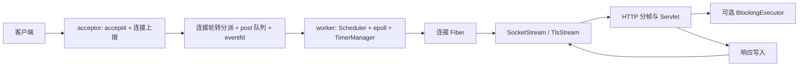

# 项目定位、简历与介绍

## 项目名称与定位

推荐名称：**基于 Boost.Context 与 epoll 的 C++ 协程服务器框架**。

解决的问题是让 Linux 服务使用顺序代码处理大量等待 I/O 的连接，同时明确超时、资源上限和停机行为。以 sylar 的模块划分为参考，构建连接 Fiber、每线程事件循环与 HTTP/WebSocket 请求链路。Boost.Context 提供有栈上下文切换；调度、I/O 等待、超时、连接生命周期和协议适配由本项目组织。

适合呈现给 C++ 后端、Linux 服务端或基础设施方向的面试。核心价值是能解释一条请求在故障与过载条件下怎样结束，并拿出代码和实验。

## 简历表述草稿

以下描述可按自己确实掌握的范围取舍。参与程度、AI 辅助方式和开发经历应与事实一致。

**基于 Boost.Context 与 epoll 的 C++ 协程服务器框架｜Linux / C++23**

- 构建 Boost.Context 有栈 Fiber、协作式 Scheduler 与每工作线程独立的 epoll 事件循环，使用 eventfd 投递跨线程任务；实现非阻塞 TCP、HTTP/1.1、HTTPS 和 WebSocket 请求链路。
- 通过 RAII 管理 socket 与连接计数，加入请求总 Deadline、协作取消、HTTP 在途准入和 WebSocket 输出预算，覆盖超时、过载拒绝和限时排空。
- 将同步数据库调用交给独立 BlockingExecutor，并提供 Redis Streams 双进程事件投递、按 ID 补读及保留窗口缺口演示；使用固定种子故障注入检查分段传输、RST 和资源回收。
- 建立原生 epoll 压测与 perf 诊断流程；WSL 同机、1000 连接、64 字节 echo、4 个压测进程条件下，4 worker 历史中位吞吐约 31 万请求/秒。核心 Release 历史完整回归 129 项测试通过。

简历篇幅较短时保留前三条，把性能条件留在项目附件中。若尚不能解释性能测量过程，就先不写最后一条。

## 60 秒介绍

> 我的项目是一个借鉴 sylar 模块划分的 C++ Linux 协程服务器框架。主要想解决两个问题：一是用顺序代码组织非阻塞网络 I/O，二是在超时、过载和连接关闭时把资源回收讲清楚。
>
> 底层使用 Boost.Context 保存有栈调用现场。每个工作线程拥有自己的 Scheduler、epoll 和定时器，连接 Fiber 固定在所属线程运行。遇到 EAGAIN 就注册等待并挂起，事件就绪后恢复；跨线程任务通过队列和 eventfd 唤醒。
>
> 在这条链路上，项目加入了请求总 Deadline、协作取消、HTTP 并发准入和 WebSocket 输出预算，也用真实 socket 和固定种子故障测试验证异常路径。性能上保留了 echo 和 HTTP 的不同结果：echo 在指定同机负载下受益于多 worker，HTTP 小响应场景仍有扩展性问题。这也是当前继续研究的方向。

这段是讲解模板，不是要求背诵的个人经历。面试官问到具体贡献时，说明哪些部分由自己分析、编码、验证，以及哪些借助 AI 完成。

## 3 分钟展开

**第 1 分钟：请求链路。** 主线程 accept4 得到非阻塞连接，在创建 Fiber 前检查连接容量。按连接轮转投递给 worker，worker 独占 Scheduler、epoll、TimerManager。SocketStream 先尝试系统调用，EAGAIN 才进入等待。事件恢复后再次尝试读写，因为就绪通知不等于请求已经完成。

**第 2 分钟：异常与资源。** HTTP 为每个请求创建同一个 30 秒 Deadline，读、业务可选阻塞任务和写共享剩余预算。取消回调回到所属 IOManager，比较当前等待状态，避免旧取消误伤新等待。HTTP permit 从解析完成后获取，一直持有到响应发送结束；异常展开时释放。阻塞函数已经开始执行时不能被 stop token 强行终止。

**第 3 分钟：证据与取舍。** 展示一个慢 socket 超时后预算归零的测试、一个 RST 后 fd 回收的测试，再展示历史性能条件。echo 的空闲定时器优化把高频创建/删除转为每连接维护一个期限，10 轮吞吐中位数约提升 4.2%。HTTP 多 worker 变慢的根因尚未证实；现有诊断指标用于缩小排查范围。

## 白板图

画图时补充：每个 worker 独立持有 W；共享配置、日志 Sink、路由和其他跨线程数据仍需同步。

## 三个最适合深入讲的设计

| 设计 | 为什么需要 | 关键取舍 | 代码入口 |
| --- | --- | --- | --- |
| 每线程 I/O 与 Fiber 归属 | 让 fd、定时器和等待状态在同一线程处理 | 不迁移现有连接；轮转不能保证负载均匀 | [IOManager](../../sylar/src/fiber/IOManager.cpp)、[IOManagerPool](../../sylar/src/fiber/IOManagerPool.cpp) |
| 总 Deadline 与状态校验 | 防止分段 I/O 每次重置超时；处理迟到取消 | 取消是协作式，运行中的第三方函数仍需自身超时 | [RequestContext](../../include/fiber/RequestContext.hpp)、[等待完成路径](../../sylar/src/fiber/IOManager.cpp) |
| 背压与可重复故障验证 | 非阻塞 I/O 仍可能保留内存和任务 | 当前只有同步发送预算，广播队列和任务队列仍有改进空间 | [OutboundBudget](../../sylar/src/http/OutboundBudget.cpp)、[故障测试](../../tests/test_http_fault_matrix.py) |

## 性能陈述卡

| 可使用的陈述 | 必须带上的条件 | 证据 |
| --- | --- | --- |
| echo 历史中位吞吐约 31 万 req/s | WSL 同机，4 worker，4 个原生压测进程，1000 连接，64 字节，10 轮每轮 10 万请求 | [echo 基准](../echo_benchmark.md) |
| echo 空闲定时器优化约提升 4.2% | 前后同一脚本，各 10 轮中位数；301516 → 314212 req/s | [echo 基准](../echo_benchmark.md) |
| HTTP 4 worker 在一组负载下约低 21% | 2026-10-02，100 个串行 keep-alive 连接，各 3 轮，未固定 CPU | [worker 诊断](../http_worker_diagnostics.md) |
| 同步日志低于 spdlog | 指定文件场景 spdlog 吞吐约高 4.6–6.1 倍；无 fsync | [日志基准](../benchmark.md) |

这些数字属于不同版本和不同负载，不能合并成当前版本的一个性能结论。HTTP QPS 与 echo 吞吐也不能相互替代。

## 面试前必须能说明的限制

C++23 是构建标准；当前 Fiber 使用 Boost.Context，未采用标准 co_await 运行时。日志是同步实现。IOManager 的 epoll 使用水平触发，没有 EPOLLET。Scheduler 是协作式，CPU 密集函数如果不让出会阻塞同线程其他 Fiber。

HTTP permit 包含响应写入，其延迟反馈会受到慢客户端影响。自适应模式是实验性控制器；一次对照无法证明它更快。BlockingExecutor 线程数有界，但提交队列未设通用硬上限。

Redis 示例每副本最多 8 个阻塞订阅，订阅会话 30 秒续订；跨副本能力由本机双进程测试验证，Kubernetes 清单尚未实机验收。Redis 游标补读可能重复，裁剪后可能丢失；XRANGE 检查与 XREAD 之间也不是原子操作，仍需进一步完善缺口识别。

## 被问到借鉴和 AI 时

可据实回答：“模块划分参考 sylar，有栈上下文依赖 Boost.Context，日志拆分参考常见 Logger/Sink/Formatter 设计。开发中使用了 AI 辅助代码和测试。我能够讲解和验证的重点是……”，然后带到已经练习过的源码和实验。不要使用“全部独立从零完成”来概括自己尚未掌握的代码。
